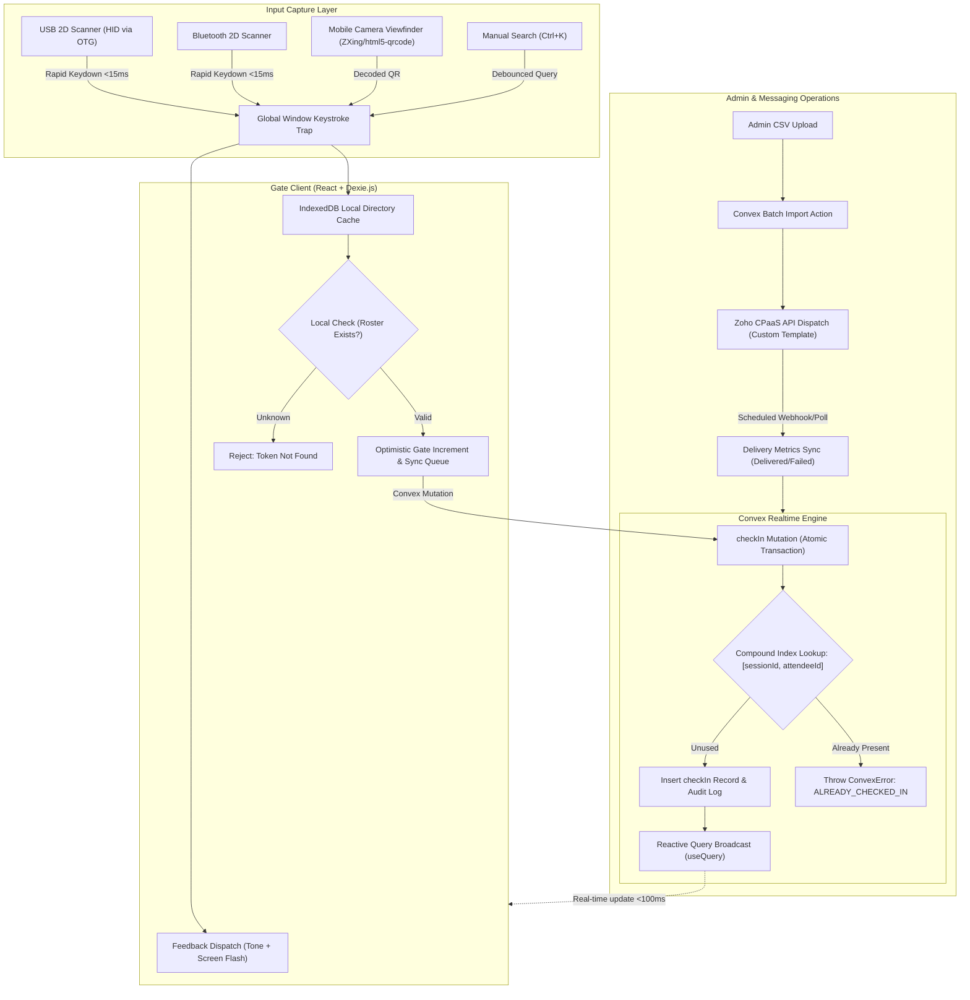

# Real-Time Event Check-In System

* **Author:** EGM Brainstorm Swarm
* **Date:** 2026-10-22

## Overview

A responsive web application for managing event access and attendance tracking for approximately 400 attendees across 2 to 5 gates simultaneously. The system runs on desktop PCs and mobile devices, integrating 2D barcode/QR scanners via USB OTG or Bluetooth keyboard emulation. It features sub-second gate validation, offline caching, real-time cross-gate duplicate prevention via Convex, live attendance dashboards, and customizable ticket dispatch using Zoho CPaaS with delivery tracking.

---

## Analysis

### 1. UX & Operator Ergonomics
* **Operator Visual Validation:** The mobile device or tablet is mounted on a stand or held directly in front of the gate operator during the check-in process. While the hardware scanner emits an internal physical decode beep upon reading a barcode, the device screen provides the actual verification:
  * *Valid Check-In:* High-contrast green background with attendee full name, company, and ticket tier displayed in large typography.
  * *Duplicate / Invalid:* High-contrast red flashing background showing the exact timestamp and gate ID where the ticket was previously checked in.
* **Minimal Screen-On & Audio Initialization:** A standard "Enter Gate" action button is provided when opening the gate interface to initialize browser `AudioContext` and request `navigator.wakeLock.request('screen')`, preventing the screen from dimming while resting on a stand.
* **Manual Lookup Drawer:** A simple manual lookup drawer accessible via hotkey (`/` or `Ctrl+K`) allows operators to search by partial name, email, or contact number when an attendee presents an unreadable QR code.
* **Mobile Camera Fallback:** Operates directly inside mobile and desktop web browsers via HTML5 WebRTC (`navigator.mediaDevices.getUserMedia`) using `@zxing/browser` or `html5-qrcode`. If granted camera permission, operators can toggle an on-screen camera viewfinder using the phone's rear camera (including flashlight toggle if supported) to scan QR codes without requiring external hardware or OTG cables.

### 2. Data Model & Multi-Session Structure
* **Event & Session Administration:** The backend supports complete administrative management of events and sessions:
  * *Events:* Event title, slug, dates, and active status.
  * *Sessions:* Session title, location/room, start time, end time, capacity limits, and session type (primary general admission vs. secondary breakout/workshop/dinner).
* **Atomic Uniqueness in Convex:** Client-only verification cannot prevent race conditions when two gates scan copies of the same pass simultaneously. The Convex database enforces uniqueness via compound indexing:
  * Table `checkIns` has an index on `["sessionId", "attendeeId"]`.
  * The `checkIn` mutation checks this index within an atomic database transaction. If an entry already exists, it aborts and returns an `ALREADY_CHECKED_IN` error containing the prior scan timestamp and gate ID.
* **Granular Attendance Tracking:** Attendance is recorded per session. An attendee checked into the primary event can subsequently be checked into distinct breakout sessions without conflicting with earlier records.

### 3. Resiliency & Scale Calibration
* **Complete Local Roster Caching:** At 400 attendees, the full event directory occupies less than 250 KB of JSON. When the gate client opens, it downloads and caches the entire directory into IndexedDB (via Dexie.js).
* **Offline Admittance & Conflict Reconciliation:**
  * When internet connectivity is present, the client verifies against IndexedDB and commits directly to Convex.
  * If connectivity drops, the client continues validating tickets against the local IndexedDB cache, stamps admissions with local timestamps, and enqueues sync tasks.
  * *Conflict Handling:* If an offline gate admits a badge that was already scanned at another online gate, Convex logs an `AUDIT_COLLISION` flag when the offline queue syncs, alerting the admin dashboard for security follow-up. For normal non-duplicate attendees, sync completes without intervention.

### 4. Hardware Scanner Integration
* **Lightweight Keystroke Interception:** The 2D USB/Bluetooth scanner outputs ticket characters followed by an `Enter` key. The client attaches a global `keydown` event listener to `window` with a short buffer. When an `Enter` key is received, the buffered token is dispatched for verification without requiring a continuously focused `<input>` field, avoiding the virtual keyboard popup on mobile.

### 5. Role-Based Access Control & Messaging
* **Admin Role:** Full permissions to:
  * Create, edit, and configure events and sessions (start/end times, room locations, capacity limits).
  * Upload CSV attendee rosters and auto-map fields.
  * Customize dispatch message templates (subject, body, dynamic placeholders like `{firstName}`, `{ticketLink}`, `{qrCode}`, `{eventName}`).
  * Dispatch email/SMS tickets via Zoho CPaaS REST API and monitor delivery metrics (Sent, Delivered, Bounced, Failed) synchronized via periodic API syncs or webhooks.
  * Monitor real-time event analytics, check-in velocity, and attendee audit logs.
* **Gate Operator Role:** Simplified interface with no administrative access. Operators log in via an Event Code, select their Gate Name, and only access scan verification, camera fallback, and manual search.

---

## Goals vs. Non-Goals

### In-Scope Goals
* **Responsive Web Application:** Operates on desktop browsers and mobile devices (Android/iOS) without native app installation.
* **Global HID Scanner Capture:** Captures USB-OTG and Bluetooth 2D barcode scanner inputs without requiring active input element focus or triggering mobile on-screen keyboards.
* **Mobile Camera Fallback:** In-browser rear camera QR scanning (`html5-qrcode` / ZXing) with permission prompt, serving as a zero-hardware mobile fallback.
* **Admin Event & Session Management:** CRUD interface for events and breakout sessions with locations, start/end timestamps, and capacities.
* **Customizable Zoho CPaaS Dispatch:** Template editor with merge tags and automated polling/webhook sync of delivery metrics (Delivered, Bounced, Failed).
* **Real-Time Cross-Gate Duplicate Prevention:** Sub-100 ms synchronization across gates using Convex reactive queries and atomic compound mutations.
* **Offline-Resilient Gate Check-In:** Local IndexedDB caching via Dexie.js for uninterrupted check-in during network dropouts, with automated queue replay.
* **Audio-Visual Gate Cues:** Synthesized Web Audio API sound generation and full-bleed colored visual alerts.
* **Multi-Session Support:** Distinct check-in records for primary event entry and individual breakout sessions.
* **Bulk Roster Import:** CSV upload with column auto-mapping and batch insertion into Convex.
* **Live Operations Dashboard:** Real-time metrics tracking total registrations, checked-in count, check-in velocity, timestamped logs, and no-shows.

### Out-of-Scope Non-Goals
* **Native App Store Distribution:** No Google Play Store or Apple App Store distribution; deployment will be a Progressive Web App (PWA).
* **Biometric Verification:** No facial recognition or photo matching.
* **Payment Processing:** No on-site ticket purchasing or refund processing.
* **Physical Badge Printing:** No thermal badge printer driver integrations (e.g., ZPL / Zebra printer drivers).

---

## Key Decisions & Staging for Next Steps

1. **Database & Sync:** Convex for real-time reactivity, combined with Dexie.js (IndexedDB) for client-side offline storage and queue management.
2. **Scanner & Camera Dual Input:** Global `window.addEventListener("keydown")` capturing buffer for hardware scanners, paired with an optional camera viewfinder fallback using `navigator.mediaDevices.getUserMedia`.
3. **Event & Session Administration:** Structured data schema supporting multi-session metadata (`startTime`, `endTime`, `location`, `capacity`).
4. **Zoho CPaaS Integration:** Template customization engine with merge tags plus scheduled Convex background actions to sync delivery status metrics.
5. **Screen & Audio Activation:** Lightweight "Enter Gate" action button to request `navigator.wakeLock` and activate the browser `AudioContext`.
6. **Token Security:** QR payloads will use high-entropy random nanoids (`ticketCode`) rather than sequential or predictable attendee IDs.
7. **Next Staging:** Advance to `/egm-draft` to construct the formal architecture and technical implementation plan.
