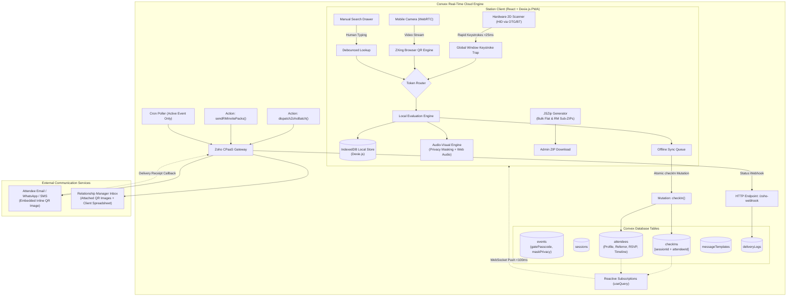

# Real-Time Event Check-In System

* **Author:** Engineering Architecture Team
* **Status:** Draft
* **Date:** 2026-10-22

--------------------------------------------------------------------------------

## Overview

Live events, conferences, and high-profile private gatherings regularly suffer from registration desk bottlenecks during arrival surges. Manual list checking is slow and error-prone, while traditional web apps frequently stall due to venue network degradation, mobile input focus loss, and latency from cloud round-trips. Furthermore, high-profile events require strict attendee privacy to prevent gate attendants or queue bystanders from viewing sensitive personal designations or corporate affiliations.

This document outlines the architecture for a responsive, offline-resilient event check-in system designed for events with approximately 400 attendees running 2 to 5 gates simultaneously. The system pairs physical 2D barcode scanners (USB-OTG / Bluetooth HID) and in-browser camera scanning with local IndexedDB roster caching, sub-100 ms Convex reactive synchronization, administrative event/session management, customizable ticket dispatch via Zoho CPaaS, dual-mode bulk QR code export for Relationship Managers (WhatsApp distribution), aesthetic public invitation and 3-way RSVP confirmation (Yes / No / Maybe), RM-wise RSVP conversion tracking, and configurable gate privacy masking.

--------------------------------------------------------------------------------

## The Problem

1. **Gate Throughput Bottlenecks:** Manual paper lookups or typing attendee names on tablets creates arrival queues. Operators require an immediate physical scan-and-go workflow with instant visual and auditory feedback.
2. **High-Profile Attendee Privacy Risks:** In sensitive and high-profile gatherings, displaying full attendee names, designations, and corporate affiliations on entrance screens risks exposing VIP identities to temporary volunteers or onlookers in line. Gate screens must support privacy masking by default.
3. **Multi-Channel Distribution (Relationship Managers & WhatsApp):** Organizers often rely on Relationship Managers (RMs) or referrers who personally invite VIPs via WhatsApp rather than standard broadcast email. Organizers need bulk QR code image exports—both as a complete archive and structured as individual sub-ZIP folders per RM—along with automated RM invite packs containing attached QR images and spreadsheets with personalized URLs.
4. **RM Accountability & RSVP Blind Spots:** Organizers lack visibility into which Relationship Managers' guests have confirmed attendance versus those who remain unresponsive. The system must track and display RM-wise conversion metrics (Yes / No / Maybe / Pending) to drive targeted follow-ups.
5. **RSVP vs. Gate Entry Disconnect:** Attendees may forget to RSVP online beforehand but still present a valid invitation QR code at the door. While the public ticket page must support 3-way RSVP tracking (Yes / No / Maybe) for catering and logistics, gate scanning must permit entry to any valid ticket holder regardless of online RSVP status.
6. **Mobile Browser HID Fragility:** 2D barcode scanners emulate USB keyboards. In mobile browsers (Chrome/Safari), reading keystrokes typically requires focusing an `<input>` field, which triggers the on-screen software keyboard, consumes screen real estate, and drops scans if the operator taps elsewhere.
7. **Venue Network Instability:** Hotel and conference center Wi-Fi or cellular networks frequently experience congestion or dropouts. If check-in relies on a synchronous server request for every scan, lines freeze immediately when connectivity drops.
8. **Cross-Gate Pass Duplication:** When multiple entrance gates operate concurrently, attendees can share screenshots or duplicate passes to gain unauthorized entry. The system must coordinate duplicate detection in real time across all active stations.

--------------------------------------------------------------------------------

## Goals

* **Sub-Second Gate Validation:** Achieve sub-200 ms scan-to-feedback latency under normal network conditions and sub-20 ms locally when offline.
* **Gate Privacy Masking:** Provide a configurable default setting (`maskAttendeeDetailsAtGate: true`) that displays only admission status ("VALID PASS - ADMIT") and Category (e.g. VIP) while masking names, designations, and companies.
* **Focus-Free Hardware Scanner Capture:** Intercept USB-OTG and Bluetooth 2D scanner keystrokes via global window listeners without requiring an active DOM input or opening the mobile virtual keyboard.
* **Camera Fallback:** Provide an in-browser WebRTC rear-camera QR scanner as a zero-hardware fallback on both mobile and desktop browsers.
* **Real-Time Cross-Gate Duplicate Prevention:** Atomically prevent pass re-use across multiple active gates via Convex compound indexed transactions (`[sessionId, attendeeId]`).
* **Offline-First Resilience:** Cache the complete attendee directory in browser IndexedDB (Dexie.js) to allow uninterrupted check-in during network dropouts, replaying scans upon reconnection.
* **Multi-Session Lifecycle Management:** Provide administrative CRUD to define events and sessions with locations, start/end timestamps, capacities, and access tiers.
* **Dual-Mode QR ZIP Export:** Export high-resolution PNG QR passes either as a single bulk dump or structured into individual sub-packs per Relationship Manager for internal WhatsApp distribution.
* **Automated RM Invite Packs & Spreadsheets:** Dispatch emails to each RM containing attached QR badge images and an attached client spreadsheet with unique ticket URLs and pre-formatted WhatsApp invite text.
* **RM-Wise RSVP Conversion Analytics:** Provide a dedicated dashboard table tracking RSVP status (Yes, Maybe, No, Pending) broken down by Relationship Manager, enabling targeted reminder triggers.
* **Aesthetic Public Ticket & 3-Way RSVP:** Provide an invitation page (`/t/:ticketCode`) displaying venue, date, schedule, and 3-way RSVP buttons ("Yes" / "No" / "Maybe") with a thank-you micro-celebration animation. Valid passes are admitted at the gate regardless of RSVP state.
* **WiserStack Brand System & 8th-Grade Language Standard:** Deliver an intuitive, minimalist UI adhering to the WiserStack color palette with plain English copy.

--------------------------------------------------------------------------------

## Non-Goals

* **Native App Store Distribution:** The system will not be distributed via Google Play Store or Apple App Store; it will be deployed as an installable Progressive Web App (PWA).
* **Biometric Verification:** No facial recognition, fingerprint scanning, or photo matching.
* **On-Site Payment Processing:** No payment gateway integrations, on-site ticket purchasing, or cash collection workflows.
* **Physical Thermal Badge Printing:** No thermal badge printer driver integrations (e.g., ZPL or ESC/POS Zebra drivers).
* **Seat Allocation & Seating Maps:** No interactive auditorium seat pickers or reserved row management.

--------------------------------------------------------------------------------

## Resolved Architectural Questions

* **Question 1 (Offline Cross-Gate Collision Resolution):**
  * *Resolution:* When an offline gate reconnects and syncs an attendee who was previously admitted at another online gate, both the operator (via a non-blocking toast banner) and the admin dashboard (via a collision audit flag) are alerted. Crucially, this notification is non-blocking and does not inhibit either the gate operator or administrator from continuing scanning operations while security investigates.
* **Question 2 (Zoho CPaaS Webhooks vs. Polling):**
  * *Resolution:* Confirmed via Zoho CPaaS API documentation. Real-time delivery status updates will be ingested through inbound webhook callbacks (`status_callback_url`) registered with Zoho CPaaS. A secondary background polling cron serves as a fallback, active strictly during the event window (up to `event.endDate`) and terminating automatically thereafter.
* **Question 3 (Gate Privacy & Data Exposure):**
  * *Resolution:* For sensitive, high-profile gatherings, the gate terminal will have `maskAttendeeDetailsAtGate` enabled by default. Only admission validity and category are displayed prominently; personal attendee details remain masked unless an intentional "Reveal Details" action is taken.
* **Question 4 (RSVP Gate Rule & Options):**
  * *Resolution:* Attendees can confirm "Yes", "No", or "Maybe" on the public ticket page for catering and logistics. If an attendee arrives with a valid QR code without having RSVP'd (or marked "Maybe"), the scanner admits them without blocking.

--------------------------------------------------------------------------------

## Critical User Journeys (CUJs)

### CUJ 1: Operator Rapid Scan Check-In with Privacy Masking (Valid Pass)
* **Given**: A gate operator has opened the check-in web application on an Android mobile device mounted on a stand with a Helett HT20 2D scanner connected via USB OTG. The operator entered their name ("John - Gate 1") and tapped "Enter Gate" (locking screen wakefulness and initializing audio). The event has `maskAttendeeDetailsAtGate: true`.
* **When**: A high-profile attendee presents a valid QR code ticket, and the operator scans it.
* **Then**: The hardware scanner beeps; the browser immediately emits a rising 587Hz-to-880Hz chime, displays a prominent high-visibility green status banner showing **"VALID PASS - ADMIT"** with category badge **"VIP"**, while the attendee's name and organization remain masked. The gate counter increments in Convex within 100 ms.

### CUJ 2: Duplicate Badge Presentation
* **Given**: Attendee A was checked in at Gate 1 at 10:14 AM. Attendee B presents a duplicate screenshot of Attendee A's QR code at Gate 2 at 10:18 AM.
* **When**: The Gate 2 operator scans the ticket.
* **Then**: Convex atomically rejects the mutation due to the compound index on `[sessionId, attendeeId]`. The Gate 2 screen displays a high-visibility crimson red warning card, plays a low 150Hz warning buzz, and displays: *"ALREADY SCANNED - Gate 1 at 10:14 AM by John"*.

### CUJ 3: Offline Check-In During Network Outage
* **Given**: Venue Wi-Fi drops completely during peak arrival. The local IndexedDB has the complete attendee roster pre-cached.
* **When**: The operator scans an attendee's QR code.
* **Then**: The client verifies the ticket token against IndexedDB in <10 ms, plays the green success chime, marks the local record as checked in with a local timestamp, and places the mutation into the Dexie sync queue. Once connectivity resumes, the queue replays transactions to Convex. If a collision occurred, a non-blocking toast alerts the operator while allowing check-ins to proceed uninterrupted.

### CUJ 4: Manual Search Fallback & Method Tracking
* **Given**: An attendee arrives with a damaged phone screen that the 2D scanner cannot read.
* **When**: The operator presses `/` or taps the search icon, types the attendee's contact number or partial name, and taps "Check In".
* **Then**: The record is displayed, the check-in mutation is dispatched with `checkInMethod: "MANUAL"`, operator name and timestamp are appended to the attendee's timeline log, and visual confirmation is displayed.

### CUJ 5: Admin Bulk Import, RM Sub-ZIP Export & Outreach Packs
* **Given**: An administrator has a CSV roster containing 400 attendee records with details (first name, last name, contact, email, designation, organization, comments, category, referrerName, referrerEmail).
* **When**: The administrator uploads the CSV:
  1. Convex ingests the roster and pre-generates unique nanoid `ticketCode` records.
  2. The administrator selects "Export QR Codes by Relationship Manager (ZIP)", downloading an archive with dedicated sub-folders per RM containing individual PNG passes and customized client spreadsheets.
  3. The administrator clicks "Email RM Invite Packs", triggering Convex to email each Relationship Manager their pack containing attached QR images, an attached client spreadsheet with links, and ready-to-copy WhatsApp snippets.
* **Then**: RMs receive their client packs immediately for WhatsApp distribution, and delivery reports populate on the dashboard.

### CUJ 6: Relationship Manager WhatsApp Outreach & Aesthetic 3-Way RSVP
* **Given**: A Relationship Manager opens their client spreadsheet or email pack and forwards an invitation on WhatsApp with the personalized badge link `https://<domain>/t/<ticketCode>` and attached QR pass.
* **When**: The guest taps the link on their smartphone, viewing an aesthetic invitation styled in the WiserStack brand palette with venue details, event date, and schedule. The guest taps "Yes, I will attend" (or "Maybe" / "Cannot attend").
* **Then**: The page renders a celebratory thank-you micro-animation confirming their response, and Convex records `rsvpStatus: "YES"` on the dashboard, updating the RM conversion table in real time. (If another invited guest arrives with their QR pass without having confirmed online, the gate scanner still admits them immediately).

--------------------------------------------------------------------------------

## Technical Plan (Architecture)

### 1. High-Level System Architecture

The application comprises three primary tiers:
1. **Station Client (Desktop & Mobile Web PWA):** A single-page application built with React, Vite, and TypeScript. It executes client-side ticket evaluation, captures hardware scanner and camera inputs, plays synthetic audio, generates dual-mode client-side QR ZIP exports, and manages local offline persistence via IndexedDB (Dexie.js).
2. **Cloud Reactive Engine (Convex):** Serverless backend providing ACID-compliant transactional mutations, real-time reactive WebSocket subscriptions, compound database indexes for duplicate prevention, and scheduled HTTP actions.
3. **External Services Tier:** Zoho CPaaS REST API for dispatching personalized tickets (Email/SMS/WhatsApp) and receiving delivery status webhooks.



---

### 2. Client-Side Subsystems

#### 2.1 Hardware Scanner Keystroke Interception (`useScanner`)
The Helett HT20 (and standard 2D scanners) transmits barcodes as high-speed keyboard strokes terminated by `Enter`. To avoid requiring focused HTML input elements—which triggers the virtual keyboard on Android/iOS—the client registers a global capturing listener on `window`:

```typescript
interface ScannerConfig {
  onScan: (barcode: string) => void;
  maxInterKeyDelayMs?: number; // Default: 25ms
  minBarcodeLength?: number;   // Default: 6 chars
}
```

* **Timing Heuristic:** Hardware scanners emit characters with inter-keystroke intervals under 25 ms. Human typing typically exceeds 70 ms.
* **Buffer Management:** Each character received with `diff < maxInterKeyDelayMs` is appended to an in-memory buffer. When `key === "Enter"`, if `buffer.length >= minBarcodeLength`, the event's default propagation is stopped, `onScan(buffer.trim())` is invoked, and the buffer is cleared.
* **Debounce Protection:** After dispatching a valid scan, an automatic 800 ms cooldown blocks duplicate physical scan triggers from the same badge in rapid succession.

#### 2.2 Mobile Camera Viewfinder Fallback (`CameraScannerModal`)
When a hardware scanner is unavailable or its battery depletes, operators can toggle an on-screen camera modal:
* Utilizes `@zxing/browser` (`BrowserQRCodeReader`) or `html5-qrcode` connected to `navigator.mediaDevices.getUserMedia({ video: { facingMode: "environment" } })`.
* Decodes incoming video frames continuously in a background canvas worker.
* Upon decoding a QR payload, it invokes `onScan()`, vibrates the mobile device via `navigator.vibrate(100)`, and can optionally remain open for continuous camera check-ins or close automatically.
* *Optional Progressive Enhancement:* A camera torch toggle is exposed only if supported natively by the device track without adding unnecessary complexity.

#### 2.3 Audio-Visual Feedback & Privacy Masking Subsystem
To ensure zero failure points on unstable networks, sound cues are synthesized entirely on the client via the Web Audio API without fetching external sound files:
* **AudioContext Singleton:** Initialized on the first explicit operator interaction ("Enter Gate" modal) via `audioContext.resume()`.
* **Success Tone:** Dual sine wave oscillators ascending from 587 Hz (D5) to 880 Hz (A5) over 120 ms with an exponential gain decay.
* **Error / Duplicate Tone:** Low saw-tooth wave at 150 Hz over 300 ms with a harsh distortion curve.
* **Screen Wake Lock:** Upon shift entry, the client requests `navigator.wakeLock.request('screen')` and hooks into `document.addEventListener('visibilitychange')` to re-acquire the lock if the operator switches browser tabs.
* **Privacy Masking UI Engine:**
  * When `event.maskAttendeeDetailsAtGate === true`:
    * Green Card: Displays **"VALID PASS - ADMIT"** in 36pt bold, with a large Category badge (e.g. `VIP` styled with Hospitality Gold `#D4AF37`). The attendee's name is masked (e.g., `A**** G*******`) and company/designation are hidden. A small secondary "Show Details" button allows the operator to unmask if manual identity verification is required.
    * Red Card: Displays **"ALREADY SCANNED"** in 36pt bold with previous scan time and gate ID.
  * When `event.maskAttendeeDetailsAtGate === false`: Displays full attendee name, designation, organization, and category.

---

### 3. Offline-First Storage & Synchronization Subsystem

#### 3.1 Local Client Database Schema (Dexie.js / IndexedDB)
```typescript
import Dexie, { Table } from "dexie";

export interface LocalAttendee {
  id: string;              // Convex Document ID
  ticketCode: string;      // Indexed lookup key
  firstName: string;
  lastName: string;
  email: string;
  contactNumber?: string;
  designation?: string;
  organization?: string;
  comments?: string;
  category: "SPONSOR" | "VISITOR" | "VIP" | "ORGANIZER";
  referrerName?: string;
  referrerEmail?: string;
  allowedSessionIds?: string[];
  checkInStatus: "REGISTERED" | "CHECKED_IN";
  rsvpStatus: "YES" | "NO" | "MAYBE" | "PENDING";
  firstSeenAt?: number;
  lastSeenAt?: number;
  checkInMethod?: "QR_SCAN" | "MANUAL";
}

export interface QueuedCheckIn {
  localId?: number;        // Auto-increment primary key
  eventId: string;
  sessionId: string;
  attendeeId: string;
  ticketCode: string;
  gateId: string;
  operatorId: string;
  operatorName: string;
  timestamp: number;
  source: "SCANNER_HID" | "CAMERA" | "MANUAL";
  syncStatus: "PENDING" | "SYNCING" | "FAILED";
}

export class GateLocalDatabase extends Dexie {
  attendees!: Table<LocalAttendee, string>;
  checkInQueue!: Table<QueuedCheckIn, number>;

  constructor() {
    super("GateLocalDatabase");
    this.version(4).stores({
      attendees: "id, ticketCode, email, lastName, contactNumber, category, referrerEmail",
      checkInQueue: "++localId, timestamp, syncStatus, attendeeId",
    });
  }
}
```

#### 3.2 Pre-Event Hydration & Local Verification Lifecycle
1. **Hydration:** When a gate operator selects an event and gate, the client invokes `useQuery(api.attendees.getRoster, { eventId })`. The complete ~200 KB JSON dataset is written directly to the Dexie `attendees` table.
2. **Scan Verification:**
   * Look up `attendees.where("ticketCode").equals(code).first()`.
   * If not found: Trigger immediate invalid scan error.
   * If found: Check local session permissions. If valid, immediately play success tone and display green banner (masked according to privacy settings).
3. **Queue Write & Background Sync:**
   * Write check-in entry to `checkInQueue` with `syncStatus: "PENDING"`.
   * If network is active, invoke Convex mutation `api.checkIns.recordCheckIn()`.
   * Upon successful mutation acknowledgement, remove the item from `checkInQueue`.
   * If network is offline, the entry remains persisted in IndexedDB. A background queue worker listens for `window.addEventListener('online')` and replays pending check-ins in chronological order.
   * *Collision Resolution:* If Convex reports that an offline scan was a duplicate of an earlier scan, the client displays a non-blocking toast alert with the collision details, and the admin dashboard receives a security flag. The operator can continue scanning without interruption.

---

### 4. Cloud Backend & Convex Data Model

The database schema (`convex/schema.ts`) enforces relational integrity, role access, and compound uniqueness:

```typescript
import { defineSchema, defineTable } from "convex/server";
import { v } from "convex/values";

export default defineSchema({
  events: defineTable({
    title: v.string(),
    slug: v.string(),
    startDate: v.number(),
    endDate: v.number(),
    location: v.string(),
    venueName: v.string(),
    venueAddress: v.optional(v.string()),
    gatePasscode: v.string(), // Passcode for gate operator shift access
    maskAttendeeDetailsAtGate: v.boolean(), // High-profile privacy flag
    active: v.boolean(),
  }).index("by_slug", ["slug"]),

  sessions: defineTable({
    eventId: v.id("events"),
    title: v.string(),
    location: v.string(),
    startTime: v.number(),
    endTime: v.number(),
    capacity: v.optional(v.number()),
    isPrimary: v.boolean(),
  }).index("by_event", ["eventId"]),

  attendees: defineTable({
    eventId: v.id("events"),
    ticketCode: v.string(), // Cryptographically random nanoid (e.g. 12 chars)
    firstName: v.string(),
    lastName: v.string(),
    email: v.string(),
    contactNumber: v.optional(v.string()),
    designation: v.optional(v.string()),
    organization: v.optional(v.string()),
    comments: v.optional(v.string()),
    category: v.union(
      v.literal("SPONSOR"),
      v.literal("VISITOR"),
      v.literal("VIP"),
      v.literal("ORGANIZER")
    ),
    referrerName: v.optional(v.string()),
    referrerEmail: v.optional(v.string()),
    rsvpStatus: v.union(
      v.literal("YES"),
      v.literal("NO"),
      v.literal("MAYBE"),
      v.literal("PENDING")
    ),
    allowedSessionIds: v.optional(v.array(v.id("sessions"))),
    checkInStatus: v.union(v.literal("REGISTERED"), v.literal("CHECKED_IN")),
    firstSeenAt: v.optional(v.number()),
    lastSeenAt: v.optional(v.number()),
    checkInMethod: v.optional(v.union(v.literal("QR_SCAN"), v.literal("MANUAL"))),
    customData: v.optional(v.any()),
  })
    .index("by_event_ticket", ["eventId", "ticketCode"])
    .index("by_event_email", ["eventId", "email"])
    .index("by_event_category", ["eventId", "category"])
    .index("by_event_referrer", ["eventId", "referrerEmail"])
    .searchIndex("search_roster", {
      searchField: "lastName",
      filterFields: ["eventId", "organization", "category", "referrerEmail"],
    }),

  checkIns: defineTable({
    eventId: v.id("events"),
    sessionId: v.id("sessions"),
    attendeeId: v.id("attendees"),
    gateId: v.string(),
    operatorId: v.string(),
    operatorName: v.string(),
    timestamp: v.number(),
    source: v.union(v.literal("SCANNER_HID"), v.literal("CAMERA"), v.literal("MANUAL")),
    isOfflineSync: v.boolean(),
    isCollision: v.boolean(), // True if admitted offline but was a duplicate
  })
    .index("by_session_attendee", ["sessionId", "attendeeId"]) // Prevents duplicate check-in
    .index("by_event_session", ["eventId", "sessionId"])
    .index("by_event_timestamp", ["eventId", "timestamp"])
    .index("by_attendee", ["attendeeId"]),

  messageTemplates: defineTable({
    eventId: v.id("events"),
    channel: v.union(v.literal("EMAIL"), v.literal("WHATSAPP"), v.literal("SMS")),
    subject: v.optional(v.string()),
    templateBody: v.string(), // Supports dynamic placeholders
    senderId: v.optional(v.string()),
  }).index("by_event_channel", ["eventId", "channel"]),

  deliveryLogs: defineTable({
    eventId: v.id("events"),
    attendeeId: v.id("attendees"),
    channel: v.string(),
    externalMessageId: v.optional(v.string()),
    status: v.union(
      v.literal("QUEUED"),
      v.literal("SENT"),
      v.literal("DELIVERED"),
      v.literal("READ"),
      v.literal("FAILED"),
      v.literal("BOUNCED")
    ),
    errorReason: v.optional(v.string()),
    timestamp: v.number(),
  })
    .index("by_event_status", ["eventId", "status"])
    .index("by_attendee", ["attendeeId"]),
});
```

#### 4.1 Transactional Check-In Mutation (`convex/checkIns.ts`)
The `recordCheckIn` mutation executes as an atomic ACID transaction:
1. Validates that the event and session exist and are active.
2. Checks compound index `by_session_attendee` on `["sessionId", "attendeeId"]`.
3. If an existing `checkIn` document exists:
   * If `isOfflineSync === false`: Immediately aborts and throws `ConvexError({ code: "ALREADY_CHECKED_IN", gate: existing.gateId, operator: existing.operatorName, time: existing.timestamp })`.
   * If `isOfflineSync === true`: Inserts the record with `isCollision: true` and logs an administrative alert for review without blocking system operations.
4. If no existing document exists:
   * Inserts the new record into `checkIns`.
   * Updates the `attendees` document with `checkInStatus: "CHECKED_IN"`, `lastSeenAt: timestamp`, `firstSeenAt: existing.firstSeenAt ?? timestamp`, and `checkInMethod: source === "MANUAL" ? "MANUAL" : "QR_SCAN"`.
   * All clients subscribed to live queries automatically receive the updated record and timeline event via WebSocket push.

#### 4.2 Public 3-Way RSVP Mutation (`convex/attendees.ts`)
The `confirmRsvp` mutation records an attendee's attendance plans:
* Ingests `ticketCode` and `response: "YES" | "NO" | "MAYBE"`.
* Updates `attendees.rsvpStatus` in real time.
* **Gate Entry Rule:** RSVP status is strictly for catering and capacity planning; presenting a valid QR pass at the entrance gate admits the attendee unconditionally.

#### 4.3 Relationship Manager Analytics Query (`convex/attendees.ts`)
The `getRMStats` query groups attendees by `referrerEmail` and computes real-time conversion metrics:
* Returns an array of RM summaries:
  ```typescript
  interface RMConversionSummary {
    referrerName: string;
    referrerEmail: string;
    totalAssigned: number;
    confirmedYes: number;
    maybe: number;
    declinedNo: number;
    pending: number;
    checkedIn: number;
  }
  ```

---

### 5. Multi-Channel Distribution & Relationship Manager Subsystem

#### 5.1 Dual-Mode Bulk QR Code Image Export (ZIP)
In the admin console, organizers can trigger two distinct ZIP export modes via `src/lib/exportZip.ts`:
* **Mode 1: "All Attendees (Single Archive)":**
  * Flat archive containing high-resolution PNG QR images sorted by category (`qrcodes/{category}/{firstName}_{lastName}_{ticketCode}.png`).
  * Includes master `all_attendees_with_links.csv`.
* **Mode 2: "Grouped by Relationship Manager (RM Bundles)":**
  * Hierarchical ZIP archive structured into dedicated folders for each Relationship Manager:
    * `RM_Packs/[RM_Name]/qrcodes/` (Individual PNG badges for their guests)
    * `RM_Packs/[RM_Name]/client_invite_sheet.csv` (Contains columns: Client Name, Designation, Organization, Contact, Unique Invite Code, Public Ticket URL, RSVP Status, and pre-formatted WhatsApp invite text).
  * Organizers can hand off individual folders or send sub-ZIPs directly to RMs for internal action.

#### 5.2 Relationship Manager (RM) Email Invite Packs with Attachments
When administrators click **"Send Invite Packs to RMs"**:
* A Convex action (`sendRMInvitePacks` in `convex/zoho.ts`) groups attendees by `referrerEmail`.
* For each RM, it dispatches an email containing:
  1. **Attached QR Badges:** High-resolution PNG image attachments for each of their assigned guests.
  2. **Attached Client Spreadsheet:** An attached CSV/Excel file listing invitee details, unique invite codes (`ticketCode`), personalized ticket URLs (`https://<domain>/t/<ticketCode>`), and current RSVP statuses.
  3. **Copy-Paste WhatsApp Blocks:** Pre-formatted message snippets directly in the email body for immediate 1-tap forwarding from mobile:
     ```text
     Dear [Client Name],
     You are cordially invited to [Event Name] on [Date] at [Venue].
     Please view your personal entry pass and confirm attendance here:
     https://event.app/t/[ticketCode]
     We look forward to hosting you.
     ```

#### 5.3 Zoho CPaaS Broadcast Dispatch (`convex/zoho.ts`)
* Administrators can send automated Email/SMS broadcasts to all or selected attendees via Zoho CPaaS REST API.
* Dynamic merge tags: `{firstName}`, `{lastName}`, `{organization}`, `{eventName}`, `{ticketLink}`, `{qrCode}`.
* Embedded inline QR image (CID attachment or image URL) with responsive web badge link as fallback.
* Delivery callbacks update `deliveryLogs` via inbound webhooks (`/zoho-webhook`), with an event-bounded cron fallback that stops when the event concludes.

---

### 6. Operations & Admin Live Dashboard

The dashboard provides real-time event analytics using Convex reactive `useQuery` hooks:
* **Metric Tiles:**
  * Total Registered Attendees (CSV imported).
  * Checked-In Count & Percentage (Primary Event).
  * RSVP Breakdown: Confirmed (Yes) vs. Maybe vs. Declined (No) vs. Pending.
  * Active In-Session Count (per breakout room).
  * Check-In Velocity (scans per minute over the last 15 minutes).
* **Relationship Manager (RM) Performance & RSVP Breakdown Table:**
  * Displays RM Name, RM Email, Total Assigned Guests, Confirmed ("Yes"), Maybe, Declined ("No"), and Pending counts.
  * Allows event organizers to sort by highest pending count and trigger a 1-click "Send Reminder Pack to RM" targeting only their unconfirmed guests.
* **Live Activity Timeline:** Chronological stream of incoming check-ins showing timestamp, attendee category, gate, operator name, check-in method (`QR_SCAN` vs `MANUAL`), and masked attendee details.
* **No-Show Directory:** Searchable table of registered attendees who have not yet checked in, with a one-click "Manual Check-In" action and "Resend Ticket" trigger.
* **Audit & Collision Log:** Dedicated table isolating flagged duplicate scans, offline collision events, and manual check-in overrides for security monitoring.

--------------------------------------------------------------------------------

## Alternatives Considered

### Alternative A: Traditional Relational SQL Stack (PostgreSQL / Supabase / Custom WebSockets)
* **Pros:** Standard SQL queries, no proprietary cloud vendor dependency, mature ecosystem for relational reporting.
* **Cons:** Requires provisioning, securing, and maintaining a backend server process, configuring connection pooling for bursty multi-gate traffic, and building custom WebSocket push notification infrastructure or relying on external Realtime listeners with custom cache synchronization.
* **Reason for Rejection:** For an event scale of ~400 attendees across 2 to 5 gates, managing server infrastructure and WebSocket connection brokers introduces operational overhead and failure points. Convex provides end-to-end type-safe reactive subscriptions, automatic client cache invalidation, and transactional ACID mutations out of the box with zero DevOps maintenance.

### Alternative B: Pure Local-Only Client Architecture (Local SQLite/IndexedDB without Cloud Backend)
* **Pros:** Complete independence from venue network conditions, zero cloud infrastructure cost, instantaneous local responses.
* **Cons:** Eliminates real-time duplicate pass detection across concurrent gates. If Attendee X shares their pass with Attendee Y, both can enter through different gates without detection until post-event manual reconciliation. Central real-time dashboard monitoring is impossible without complex peer-to-peer ad-hoc local mesh networking across volatile mobile devices.
* **Reason for Rejection:** Cross-gate duplicate detection and a centralized real-time dashboard are core operational requirements. The hybrid architecture (Dexie.js IndexedDB local roster cache + Convex cloud reactive sync) provides local offline resilience while maintaining real-time cross-gate protection whenever connectivity is present.

### Alternative C: Native Mobile Applications (React Native or Flutter via App Stores)
* **Pros:** Direct low-level USB OTG driver access, native background thread execution, uninhibited audio playback and screen wakefulness without browser security restrictions.
* **Cons:** High distribution friction. Requires packaging APKs/IPAs, navigating app store review processes, managing test flight or sideloading across temporary volunteer and operator devices, and maintaining separate desktop web builds for administrative operations.
* **Reason for Rejection:** A Progressive Web App (PWA) with browser Web Audio API, `navigator.wakeLock`, and window-level keyboard event interception functions uniformly across Android phones, tablets, laptops, and desktop PCs without installation barriers or OS-specific codebases.

### Alternative D: Sequential Attendee ID Barcodes (e.g., `ATT-001`, `ATT-002`)
* **Pros:** Simple to generate, human-readable for manual operator troubleshooting.
* **Cons:** Highly vulnerable to guessing and fraud. Any attendee receiving a pass could easily predict and generate valid QR codes for other attendees.
* **Reason for Rejection:** Replaced with cryptographically random 12-character nanoid tokens (`ticketCode`) that cannot be guessed or forged.

--------------------------------------------------------------------------------

## Non-Functional Requirements

### Security & Privacy
* **Token Entropy:** Ticket QR codes contain high-entropy nanoids (`ticketCode`) mapped to internal attendee IDs.
* **Gate Privacy Masking:** High-profile event attendee details are masked by default on gate terminals, displaying admission status and category while hiding full names and company affiliations.
* **Credential Isolation:** Zoho CPaaS API credentials, auth tokens, and sender IDs are stored securely as Convex server-side environment secrets (`ZOHO_CPAAS_API_KEY`, `ZOHO_SENDER_ID`) and never exposed to the client bundle.
* **Role Separation:** Gate operators log in using an Event Access Code and select their assigned Gate Name; they are restricted to scan verification and manual attendee search, with no access to CSV import, template editing, or bulk message dispatching.

### Performance & Latency Targets
* **Local Scan Validation:** Sub-10 ms execution time against the local IndexedDB cache.
* **Cloud Sync Latency:** Sub-150 ms end-to-end mutation and reactive WebSocket push to the live dashboard under typical 4G/Wi-Fi conditions.
* **Pre-Shift Hydration:** Under 500 ms to download and index the entire ~200 KB event roster (400 attendees) into IndexedDB at gate station startup.

### Reliability & Operational Continuity
* **Network Degradation Immunity:** Full offline operation via Dexie.js with automatic chronological sync replay upon network restoration.
* **Non-Blocking Operation:** Duplicate collisions and network warnings are displayed as non-blocking alerts, ensuring operator queues never freeze.
* **Event-Bounded Resource Management:** Polling crons evaluate event end timestamps and cease execution once the event is concluded.

--------------------------------------------------------------------------------

### Future Improvements

* **Self-Service Check-In Kiosks:** A dedicated full-screen self-check-in kiosk mode for unattended tablets.
* **Thermal Badge Printing:** Direct WebUSB / WebBluetooth integration with ESC/POS or ZPL label printers for automated name tag printing upon successful scan.
* **Interactive WhatsApp Confirmation:** Two-way WhatsApp message integration allowing attendees to confirm attendance or receive real-time schedule updates via Zoho CPaaS inbound messaging.

--------------------------------------------------------------------------------

## Detailed Implementation Plan

### 1. UI/UX Design System (WiserStack Brand Palette) & 8th-Grade Language Standard

The user experience adheres strictly to a modern, minimalist SaaS aesthetic designed for effortless comprehension (targeting an 8th-grade reading level):

* **WiserStack Brand Palette Tokens:**
  * **Primary Navy (`#002060`):** Core brand color. Used for primary buttons, active state indicators, and top headers.
  * **Light Brand Blue (`#BCC0E8`):** Secondary accent, subtle pill backgrounds, and interactive card highlights.
  * **Soft Divider / Border (`#E8ECF8`):** Subtle card borders, table dividers, and structural outlines.
  * **Very Light Blue Background (`#F5F7FD`):** Page surface background, providing a clean, aesthetic feel.
  * **Black (`#000000`) & White (`#FFFFFF`):** High-contrast typography and pure white card surfaces.
  * **Hospitality Gold (`#D4AF37`):** VIP badges, celebratory confetti accents, and special category indicators.
* **Visual Geometry:**
  * Cards use pure white (`#FFFFFF`) surfaces resting on the very light blue (`#F5F7FD`) canvas with soft borders (`#E8ECF8`) and rounded-2xl geometry.
  * Touch targets are large and accessible (minimum 48px height), preventing accidental miss-taps on mobile gate stands.
  * Clear iconography powered by Lucide icons.
* **Language & Copywriting Standards (8th-Grade Level):**
  * Plain English copy across all interfaces:
    * Instead of *"ACID Mutation Committed"*, use *"Pass Valid - Admit"*.
    * Instead of *"Compound Uniqueness Conflict Detected"*, use *"Already Scanned at Gate 1"*.
    * Instead of *"Synchronizing IndexedDB Cache"*, use *"Updating Guest List"*.
    * Instead of *"Authenticate Public Token"*, use *"View Your Entry Pass"*.
    * Instead of *"RSVP Submission Action"*, use *"Yes, I'll be there"*.

#### 1.1 Gate Terminal Screen (`/gate/:slug`)
* **Header Bar (Sticky Top):**
  * Left: Event Title and active Session badge ("Main Entry - Primary").
  * Center: Live counter pill (`Checked In: 184 / 400`).
  * Right: Network sync pill (Green dot: "Online", Amber dot: "Offline - 3 Saved").
* **Central Hero Verification Card:**
  * *Standby State:* Pulsing radar icon with plain text: *"Ready to Scan — Present QR Pass"*.
  * *Valid Scan State (Privacy Masked):* High-contrast emerald card displaying **"VALID PASS - ADMIT"** (36pt bold) with a prominent Category badge (e.g., `VIP` in Hospitality Gold). Full name is masked (`A**** G*******`) and designation is hidden by default. An optional "Show Details" button reveals the full profile if needed.
  * *Duplicate Scan State:* High-contrast crimson card displaying: **"⚠️ ALREADY SCANNED"** (36pt bold), showing the exact previous scan time, gate identifier, and operator name. Includes an "Acknowledge" button to dismiss early.
  * *Session Mismatch State:* Amber card showing: **"Access Restricted: This pass is not valid for this room"**.
* **Bottom Action Dock (Sticky Bottom):**
  * `[Find Guest (/)]`: Opens the manual lookup drawer.
  * `[Use Camera]`: Opens the on-screen video viewfinder fallback modal.
  * `[Shift Info]`: Displays operator name and active station identifier.

#### 1.2 Admin Operations Dashboard (`/admin/events/:slug`)
* **Top Metric Ribbon:** Five stat cards:
  1. *Total Registered* (with category breakdown).
  2. *Total Checked In* (% progress bar).
  3. *RSVP Breakdown* (Yes / Maybe / No / Pending).
  4. *Current In-Room Attendance* (session selector dropdown).
  5. *Check-In Velocity* (arrivals in the last 15 minutes).
* **RM Performance & RSVP Table:** Real-time breakdown by Relationship Manager showing Total Assigned Guests, Confirmed ("Yes"), Maybe, Declined ("No"), and Pending. Allows 1-click follow-up pack generation.
* **Live Arrival Feed (Left Column / Main Tab):** Real-time descending list of scans with attendee category, gate, operator name, check-in method pill (`QR_SCAN` vs `MANUAL`), and relative timestamp ("Just now", "2m ago").
* **Security & Collision Table (Right Column / Tab):** Highlights duplicate attempts, offline collision syncs, and manual override actions.
* **Action Header:** Quick-access buttons for `[Import CSV]`, `[Export QR (ZIP)]`, `[Invite Packs]`, and `[Manage Sessions]`.

#### 1.3 Attendee Management Console (`/admin/events/:slug/attendees`)
* **CSV Upload Dropzone:** Drag-and-drop CSV importer with column auto-mapper (`First Name`, `Last Name`, `Contact`, `Email`, `Designation`, `Organization`, `Comments`, `Category`, `Referrer Name`, `Referrer Email`). Displays a 5-row preview before committing.
* **Roster Table:** Searchable and filterable by Category (`SPONSOR`, `VISITOR`, `VIP`, `ORGANIZER`), RSVP Status (`YES`, `NO`, `MAYBE`, `PENDING`), and Referrer / Relationship Manager.
* **Row Actions:** "View Timeline" (shows `firstSeenAt`, `lastSeenAt`, `checkInMethod`), "Copy Ticket Link", and "Manual Check-In".

#### 1.4 Step-by-Step Ticket Dispatch & RM Console (`/admin/events/:slug/dispatch`)
* **Tab 1: Relationship Manager Outreach:**
  * Options for "Export All QR Codes (Single Archive)" or "Export Grouped by RM (Sub-ZIPs)".
  * "Email RM Invite Packs" trigger: Sends emails to RMs containing attached QR badge images, an attached client spreadsheet with links, and pre-formatted WhatsApp snippets.
* **Tab 2: Direct Broadcast (Zoho CPaaS):**
  * Step 1: Recipient Selection: Select all or filtered attendees.
  * Step 2: Template Customization: Rich textarea supporting merge tag helper chips: `{firstName}`, `{lastName}`, `{organization}`, `{eventName}`, `{ticketLink}`, `{qrCode}`.
  * Step 3: Live Preview & Dispatch: Split view displaying email/SMS preview with embedded inline QR code image.
* **Delivery Metrics Section:** Real-time donut chart and table tracking Zoho CPaaS receipts (`SENT`, `DELIVERED`, `BOUNCED`, `FAILED`).

#### 1.5 Public Responsive Attendee Ticket & 3-Way RSVP (`/t/:ticketCode`)
* **Aesthetic Event Presentation (WiserStack Palette):**
  * Soft `#F5F7FD` background with a centered white card bordered in `#E8ECF8`.
  * Prominently displays: Event Title, Venue Name & Address, Event Date & Start/End Time.
  * Attendee Category tag (with Hospitality Gold `#D4AF37` for VIPs).
  * Centered high-contrast QR entry pass.
* **3-Way RSVP Card:**
  * Heading: *"Will you be joining us?"*
  * Three interactive buttons:
    * `[Yes, I'll be there]` (Primary Navy `#002060` with white text and checkmark)
    * `[Maybe]` (Light Blue `#BCC0E8` with dark navy text)
    * `[Cannot attend]` (White surface with `#E8ECF8` border and slate text)
* **Post-Submission Celebration State:**
  * Upon clicking an RSVP button, the card smoothly transitions to an aesthetic thank-you message: *"Thank you! Your response has been recorded."*
  * Triggers a subtle CSS/canvas confetti micro-celebration animation.
  * Preserves the "Download Pass / Save to Phone" action so guests can save their pass anytime.

---

### 2. Authentication & Access Control Architecture

To ensure security while eliminating setup friction for temporary event staff:

* **Admin Role (Organizer Access):**
  * Powered by **Convex Auth** (`@convex-dev/auth`), a zero-dependency native authentication engine running inside Convex.
  * Admins log in via Email/Password or Passwordless Magic Link at `/login`.
  * Protects administrative routes (`/admin/*`), CSV imports, Zoho CPaaS API dispatching, and sensitive attendee contact data.
* **Gate Operator Role (High-Speed Gate Access):**
  * Uses an **Event Gate Passcode + Operator Display Name** modal at `/gate/:slug`.
  * The event admin sets a simple Gate Passcode in the event settings (e.g., `GATE-2026`).
  * When opening the gate terminal on mobile or PC, the operator enters the Event Passcode, enters their display name (e.g., "Sarah - East Door"), and selects their gate.
  * The client validates the passcode via a Convex query and caches the temporary gate session token in `localStorage`.
  * **Benefit:** Volunteers do not need to create individual email accounts or remember complex passwords, enabling gate onboarding in under 15 seconds while retaining complete audit attribution (`operatorName` and `gateId` attached to every check-in).

---

### 3. Target Files to Create/Modify

#### 1. `package.json` (Create)
* **Type / Scope**: Project Dependency & Script Configuration
* **Proposed Changes**: Defines project metadata, build scripts (`dev`, `build`, `test`), and core production dependencies: `react`, `react-dom`, `convex`, `@convex-dev/auth`, `dexie`, `lucide-react`, `clsx`, `tailwind-merge`, `@zxing/browser`, `nanoid`, `papaparse`, `qrcode`, `jszip`, `canvas-confetti`. Defines devDependencies: `vite`, `typescript`, `@types/react`, `@types/react-dom`, `@types/papaparse`, `@types/qrcode`, `@types/canvas-confetti`, `tailwindcss`, `postcss`, `autoprefixer`, `vitest`, `@testing-library/react`.

#### 2. `vite.config.ts` (Create)
* **Type / Scope**: Build Bundler Configuration
* **Proposed Changes**: Configures Vite with `@vitejs/plugin-react`, path aliasing (`@` -> `./src`), and PWA service worker registration.

#### 3. `tsconfig.json` & `tsconfig.node.json` (Create)
* **Type / Scope**: TypeScript Compiler Configuration
* **Proposed Changes**: Enforces strict null checks, modern ES module resolution, and path mappings for `@/*`.

#### 4. `tailwind.config.js` & `postcss.config.js` (Create)
* **Type / Scope**: Styling & Design System Configuration
* **Proposed Changes**: Configures Tailwind CSS content paths, animation keyframes for status card transitions, and the official WiserStack brand palette: `brand-navy` (`#002060`), `brand-blue-light` (`#BCC0E8`), `brand-border` (`#E8ECF8`), `brand-bg` (`#F5F7FD`), and `brand-gold` (`#D4AF37`).

#### 5. `index.html` (Create)
* **Type / Scope**: HTML5 Web Shell
* **Proposed Changes**: Sets viewport meta tags preventing mobile zooming (`user-scalable=no`), sets `theme-color` to `#002060`, and registers web app capability headers.

#### 6. `convex/schema.ts` (Create)
* **Type / Scope**: Convex Database Schema
* **Proposed Changes**: Defines database tables: `events` (with `venueName`, `venueAddress`, `gatePasscode`, `maskAttendeeDetailsAtGate`), `sessions`, `attendees` (with `referrerName`, `referrerEmail`, `rsvpStatus: "YES" | "NO" | "MAYBE" | "PENDING"`), `checkIns`, `messageTemplates`, `deliveryLogs`, and Convex Auth tables (`users`, `sessions`). Defines compound indexes on `checkIns` by `["sessionId", "attendeeId"]` and `attendees` by `["eventId", "ticketCode"]`.

#### 7. `convex/auth.ts` (Create)
* **Type / Scope**: Convex Auth Backend Configuration
* **Proposed Changes**: Configures `@convex-dev/auth` with Password / Email authentication providers for administrative users.

#### 8. `convex/events.ts` (Create)
* **Type / Scope**: Convex Backend Module (Events)
* **Proposed Changes**: Queries and mutations for administrative event lifecycle (`createEvent`, `updateEvent`, `getEvent`, `listEvents`, `verifyGatePasscode`).

#### 9. `convex/sessions.ts` (Create)
* **Type / Scope**: Convex Backend Module (Sessions)
* **Proposed Changes**: Queries and mutations to manage event sub-sessions and breakout rooms (`createSession`, `listSessionsByEvent`, `updateSession`, `deleteSession`).

#### 10. `convex/attendees.ts` (Create)
* **Type / Scope**: Convex Backend Module (Attendees & RM Analytics)
* **Proposed Changes**: `getRoster`, `batchImportAttendees` (with nanoid generation), `searchAttendees`, `updateAttendee`, `confirmRsvp` mutation, and `getRMStats` query returning the RM-wise RSVP breakdown.

#### 11. `convex/checkIns.ts` (Create)
* **Type / Scope**: Convex Backend Module (Check-In Transactions & Queries)
* **Proposed Changes**: `recordCheckIn` (atomic compound index uniqueness check on `[sessionId, attendeeId]`), `getLiveStats`, `getRecentCheckIns`, and `resetCheckIn`.

#### 12. `convex/zoho.ts` (Create)
* **Type / Scope**: Convex Backend Action (Zoho CPaaS & RM Integration)
* **Proposed Changes**: `dispatchTicketBatch`, `sendRMInvitePacks` (generates emails with attached QR badges and attached client spreadsheets with links), `syncDeliveryStatusCron` (event-bounded active polling), and `resendTicket`.

#### 13. `convex/http.ts` (Create)
* **Type / Scope**: Convex Inbound HTTP Router
* **Proposed Changes**: Exposes `POST /zoho-webhook` to ingest delivery receipts from Zoho CPaaS and update `deliveryLogs` in real time, plus Convex Auth HTTP routes.

#### 14. `convex/crons.ts` (Create)
* **Type / Scope**: Convex Cron Schedule
* **Proposed Changes**: Configures the 15-minute scheduled call to `api.zoho.syncDeliveryStatusCron`.

#### 15. `src/lib/db.ts` (Create)
* **Type / Scope**: Client Local Storage (Dexie.js)
* **Proposed Changes**: Initializes `GateLocalDatabase` extending Dexie, declaring `attendees` and `checkInQueue` object stores.

#### 16. `src/lib/audio.ts` (Create)
* **Type / Scope**: Client Audio Synthesis (Web Audio API)
* **Proposed Changes**: Implements `AudioContext` singleton management with `unlockAudio()`, `playSuccessChime()` (587Hz -> 880Hz), and `playErrorBuzz()` (150Hz sawtooth).

#### 17. `src/lib/wakeLock.ts` (Create)
* **Type / Scope**: Browser Screen Wake Lock Utility
* **Proposed Changes**: Manages `navigator.wakeLock.request('screen')` with automatic re-acquisition on `document.visibilityState === 'visible'`.

#### 18. `src/lib/exportZip.ts` (Create)
* **Type / Scope**: Client-Side Bulk Asset Pack Generator (JSZip)
* **Proposed Changes**: Generates high-res PNG QR codes in bulk and supports both flat single-archive export and hierarchical sub-ZIPs structured by Relationship Manager.

#### 19. `src/hooks/useScanner.ts` (Create)
* **Type / Scope**: Custom React Hook (Hardware Scanner Interception)
* **Proposed Changes**: Registers a window-level capturing `keydown` listener, buffers characters arriving with <25 ms delay, stops event propagation on `Enter`, enforces 800 ms debounce, and passes parsed barcode to callback.

#### 20. `src/hooks/useCameraScanner.ts` (Create)
* **Type / Scope**: Custom React Hook (Camera Fallback)
* **Proposed Changes**: Manages video stream initialization with `@zxing/browser`, frame-by-frame QR scanning, flashlight track control, and device vibration.

#### 21. `src/hooks/useOfflineSync.ts` (Create)
* **Type / Scope**: Custom React Hook (IndexedDB & Sync Engine)
* **Proposed Changes**: Preloads Convex roster into Dexie on mount, evaluates scans against IndexedDB in sub-10 ms, queues mutations locally when offline, and replays pending check-ins upon network reconnection.

#### 22. `src/pages/LoginPage.tsx` (Create)
* **Type / Scope**: Admin Authentication Page
* **Proposed Changes**: Clean, minimalist login interface styled with WiserStack navy and light blue for event administrators with Email and Password / Magic Link authentication.

#### 23. `src/pages/GateCheckInPage.tsx` (Create)
* **Type / Scope**: Gate Operator User Interface
* **Proposed Changes**: Gate terminal interface with "Enter Gate" shift initialization modal, high-visibility status card with privacy masking (green valid / red duplicate / amber limit), recent scan feed, manual search drawer trigger, and camera fallback button.

#### 24. `src/pages/AdminDashboardPage.tsx` (Create)
* **Type / Scope**: Admin Operations Dashboard
* **Proposed Changes**: Real-time metric cards (total, checked-in, 3-way RSVP breakdown, velocity, session breakdown), RM performance & RSVP breakdown table, live activity stream, and security collision table.

#### 25. `src/pages/AttendeeManagerPage.tsx` (Create)
* **Type / Scope**: Attendee Administration Console
* **Proposed Changes**: Drag-and-drop CSV upload with column auto-mapper (including Referrer fields), searchable roster table with category pills and RM filters, check-in method badges (`QR_SCAN` vs `MANUAL`), and attendee timeline drawer.

#### 26. `src/pages/TicketDispatchPage.tsx` (Create)
* **Type / Scope**: Ticket Messaging & RM Console
* **Proposed Changes**: Multi-channel dispatch interface: dual-mode ZIP export buttons, RM invite pack trigger with attachments, dynamic template editor with embedded QR image preview, batch send execution, and live delivery status charts.

#### 27. `src/pages/PublicTicketPage.tsx` (Create)
* **Type / Scope**: Attendee Responsive Web Ticket & RSVP (`/t/:ticketCode`)
* **Proposed Changes**: Public mobile-optimized badge page styled in WiserStack palette displaying venue name, event schedule, high-contrast SVG QR code, 3-way RSVP confirmation buttons ("Yes" / "No" / "Maybe"), thank-you celebration animation, and download image button.

#### 28. `src/components/GateLoginModal.tsx` (Create)
* **Type / Scope**: Gate Operator Passcode & Shift Setup Modal
* **Proposed Changes**: Prompts for Event Gate Passcode, Gate Identifier (e.g., Gate 1), and Operator Display Name before entering the scan terminal.

#### 29. `src/components/CameraScannerModal.tsx` (Create)
* **Type / Scope**: On-Screen Camera Viewfinder Modal
* **Proposed Changes**: Overlay camera viewfinder with live video feed, scan target box, torch toggle, and close control.

#### 30. `src/components/ManualSearchModal.tsx` (Create)
* **Type / Scope**: Manual Attendee Lookup Modal
* **Proposed Changes**: Keyboard-accessible (`Ctrl+K` or `/`) drawer for instant name, phone, or email lookup with one-click manual check-in.

#### 31. `tests/unit/useScanner.test.ts` (Create)
* **Type / Scope**: Vitest Unit Test
* **Proposed Changes**: Tests rapid keystroke burst handling (<25 ms) vs slow typing (>70 ms), verifying that only barcode streams trigger `onScan`.

#### 32. `tests/unit/checkIns.test.ts` (Create)
* **Type / Scope**: Vitest / Convex Mutation Test
* **Proposed Changes**: Validates compound index enforcement on `[sessionId, attendeeId]`, ensuring duplicate check-ins are rejected when online and flagged as collisions when synced from offline.

#### 33. `tests/unit/audio.test.ts` (Create)
* **Type / Scope**: Vitest Unit Test
* **Proposed Changes**: Tests Web Audio API oscillator parameters, gain ramp-downs, and fallback error handling.

#### 34. `tests/unit/offlineQueue.test.ts` (Create)
* **Type / Scope**: Vitest Unit Test
* **Proposed Changes**: Tests Dexie IndexedDB queue enqueueing, chronological dequeueing, and duplicate local avoidance.

#### 35. `tests/unit/auth.test.ts` (Create)
* **Type / Scope**: Vitest Unit Test
* **Proposed Changes**: Tests gate passcode verification logic, operator attribution persistence, and admin session guarding.

---

### 4. Verification Plan

* **Compilation & Type Check**:
  * Command: `npx tsc --noEmit`
  * Requirement: Zero TypeScript compiler errors with `strict: true`.
* **Vite Production Build**:
  * Command: `npm run build`
  * Requirement: Successful asset bundling, generating standalone HTML/JS/CSS assets without unresolved external dependencies.
* **Unit & Subsystem Tests**:
  * Command: `npm run test`
  * Requirement: 100% passing test suite across `useScanner`, `checkIns`, `audio`, `offlineQueue`, and `auth`.
* **Hardware & Timing Simulation**:
  * Verify barcode keystroke accumulator with synthetic 15 ms keystroke bursts followed by Enter.
  * Verify that human typing (80 ms intervals) does not trigger barcode scan dispatch.
* **Offline & Collision Resilience Verification**:
  * Simulate browser offline state (`navigator.onLine = false`), record 5 scans into IndexedDB, reconnect, and verify automated chronological replay to Convex.
  * Verify that duplicate offline scans across two simulated gates generate `isCollision: true` records without freezing either client interface.
* **End-to-End User Verification**:
  * Verify CSV import with 400 sample attendee records, mapping referrer details.
  * Verify client-side ZIP generation of individual PNG QR codes in both flat and RM-grouped sub-ZIP formats.
  * Verify RM invite pack emails contain attached QR badges and attached client spreadsheets.
  * Verify RM performance table on the dashboard correctly displays counts for Confirmed, Maybe, Declined, and Pending guests.
  * Verify public ticket page 3-way RSVP ("Yes, I'll be there" / "Maybe" / "Cannot attend") with WiserStack aesthetic styling and celebratory thank-you state.
  * Verify gate terminal green status card with privacy masking enabled by default.

--------------------------------------------------------------------------------

*Drafted with EGM*
