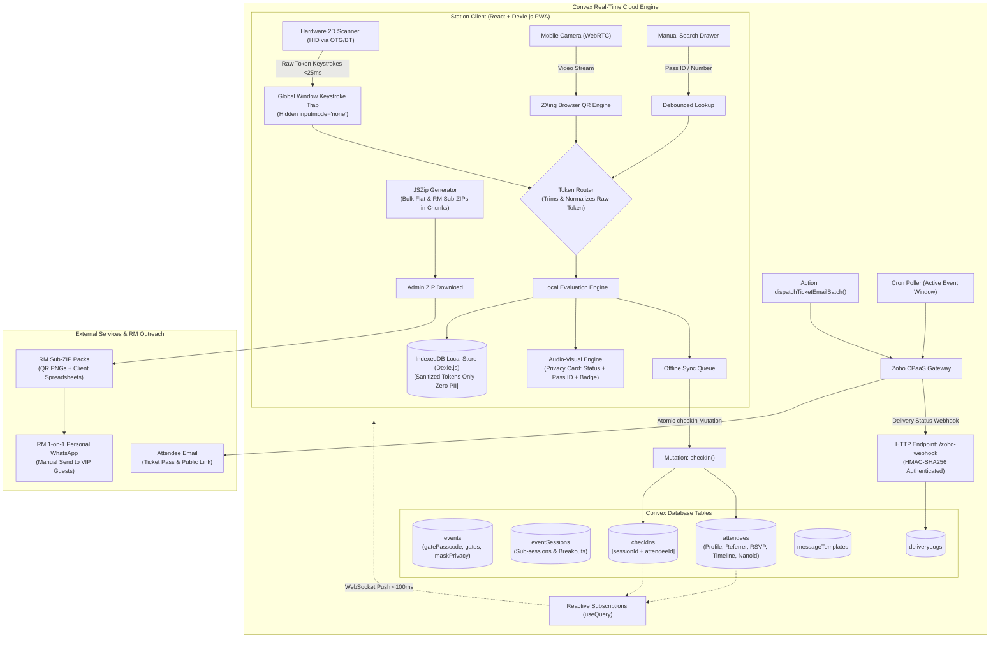

# Real-Time Event Check-In System

* **Author:** Engineering Architecture Team
* **Status:** Reviewed & Approved
* **Date:** 2026-10-22

---

## Overview

Live events, conferences, and high-profile private gatherings regularly suffer from registration desk bottlenecks during arrival surges. Manual list checking is slow and error-prone, while traditional web apps frequently stall due to venue network degradation, mobile input focus loss, and latency from cloud round-trips. Furthermore, high-profile events require strict attendee privacy to prevent gate attendants or queue bystanders from viewing sensitive personal designations, corporate affiliations, or contact details.

This document outlines the architecture for a responsive, offline-resilient event check-in system designed for events with approximately 400 attendees running 2 to 5 gates simultaneously on PC and mobile devices. The system pairs physical 2D barcode scanners (USB-OTG / Bluetooth HID) and in-browser camera scanning with local IndexedDB roster caching, sub-100 ms Convex reactive synchronization, administrative event/session management, transactional ticket email dispatch via Zoho CPaaS, dual-mode bulk QR code export for Relationship Managers (1-on-1 personal WhatsApp distribution), branded public invitation and 3-way RSVP confirmation (Yes / No / Maybe), RM-wise RSVP conversion tracking, and ironclad gate privacy sanitization.

---

## The Problem

1. **Gate Throughput Bottlenecks:** Manual paper lookups or typing attendee names on tablets creates arrival queues. Operators require an immediate physical scan-and-go workflow with instant visual and auditory feedback.
2. **High-Profile Attendee Privacy & Device Security:** In sensitive gatherings, displaying full attendee names, designations, and corporate affiliations on entrance screens risks exposing VIP identities to temporary volunteers or onlookers in line. Furthermore, downloading complete attendee contact directories onto volunteers' personal smartphones creates severe data protection vulnerabilities. Gate volunteer devices must display and store strictly admission validation tokens, with zero personal PII cached locally.
3. **Multi-Channel Distribution (Relationship Managers & 1-on-1 WhatsApp):** Organizers often invite VIPs through Relationship Managers (RMs) or referrers who personally message guests via WhatsApp on a 1-on-1 basis rather than sending generic automated broadcast blasts. Organizers need bulk QR code image exports—both as a single archive and structured as individual sub-ZIP folders per RM—along with customized client spreadsheets containing unique pass URLs and pre-formatted invite copy ready for RMs to copy-paste.
4. **RM Accountability & RSVP Blind Spots:** Organizers lack visibility into which Relationship Managers' guests have confirmed attendance versus those who remain unresponsive. The system must track and display RM-wise conversion metrics (Yes / No / Maybe / Pending) to drive targeted follow-ups.
5. **RSVP vs. Gate Entry Disconnect:** Attendees may forget to RSVP online beforehand but still present a valid invitation QR code at the door. While the public ticket page must support 3-way RSVP tracking (Yes / No / Maybe) for catering and logistics, gate scanning must permit entry to any valid ticket holder regardless of online RSVP status.
6. **Mobile Browser HID Fragility:** 2D barcode scanners emulate USB keyboards. In mobile browsers (Chrome/Safari), reading keystrokes typically requires focusing an `<input>` field, which triggers the on-screen software keyboard, consumes screen real estate, and drops scans if the operator taps elsewhere.
7. **Venue Network Instability:** Hotel and conference center Wi-Fi or cellular networks frequently experience congestion or dropouts. If check-in relies on a synchronous server request for every scan, lines freeze immediately when connectivity drops.
8. **Cross-Gate Pass Duplication:** When multiple entrance gates operate concurrently, attendees can share screenshots or duplicate passes to gain unauthorized entry. The system must coordinate duplicate detection in real time across all active stations.

---

## Goals

* **Sub-Second Gate Validation:** Achieve sub-200 ms scan-to-feedback latency under normal network conditions and sub-20 ms locally when offline.
* **Gate Volunteer Device Privacy Sanitization:** Provide a default privacy configuration (`maskAttendeeDetailsAtGate: true`) where volunteer gate devices only store and display the Attendee/Pass ID (e.g. `ATT-409`), Category badge (e.g. `VIP`), and Admission Status (`VALID PASS - ADMIT` vs `ALREADY CHECKED IN`). Full attendee names, phone numbers, emails, and company designations are completely excluded from local device storage and gate screens.
* **Raw Token QR Encoding (No URLs in QR):** Encode strictly the raw unique ticket code / hex token (e.g., 12-character nanoid `V1StGXR8_Z5j` or `ATT-8F3A29`) into the physical QR code image, minimizing QR density, maximizing scan readability on budget scanners (e.g., Helett HT20), and eliminating URL parsing ambiguity. The public pass URL (`https://<domain>/t/:ticketCode`) is distributed separately.
* **Focus-Free Hardware Scanner Capture:** Intercept USB-OTG and Bluetooth 2D scanner keystrokes via global window listeners anchored to a hidden off-screen input, preventing mobile virtual keyboard popups while ignoring keystrokes when the operator is typing in modal input fields.
* **Camera Fallback:** Provide an in-browser WebRTC rear-camera QR scanner as a zero-hardware fallback on both mobile and desktop browsers.
* **Real-Time Cross-Gate Duplicate Prevention:** Atomically prevent pass re-use across multiple active gates via Convex compound indexed transactions (`[sessionId, attendeeId]`).
* **Offline-First Resilience:** Cache the sanitized validation directory in browser IndexedDB (Dexie.js) to allow uninterrupted check-in during network dropouts, replaying scans upon reconnection.
* **Multi-Session Lifecycle Management:** Provide administrative CRUD to define events and sub-sessions (`eventSessions`) with locations, start/end timestamps, capacities, and access tiers.
* **Dual-Mode QR ZIP Export:** Export high-resolution PNG QR passes either as a single bulk dump or structured into individual sub-packs per Relationship Manager for 1-on-1 WhatsApp distribution.
* **RM Invite Packs & Spreadsheets:** Provide RM invite packs containing individual attendee QR PNG images and an attached client spreadsheet with unique ticket URLs and pre-formatted WhatsApp invite snippets for 1-on-1 messaging.
* **RM-Wise RSVP Conversion Analytics:** Provide a dedicated dashboard table tracking RSVP status (Yes, Maybe, No, Pending) broken down by Relationship Manager, enabling targeted reminder triggers.
* **Branded Public Ticket & 3-Way RSVP:** Provide an invitation page (`/t/:ticketCode`) displaying venue, date, schedule, raw-token QR pass, and 3-way RSVP buttons ("Yes" / "No" / "Maybe") with a thank-you micro-celebration animation. Valid passes are admitted at the gate regardless of RSVP state.
* **WiserStack Brand System & 8th-Grade Language Standard:** Deliver an intuitive, minimalist UI adhering to the WiserStack color palette with plain English copy.

---

## Non-Goals

* **Native App Store Distribution:** The system will not be distributed via Google Play Store or Apple App Store; it will be deployed as an installable Progressive Web App (PWA).
* **Automated WhatsApp Bot / Meta Business API Broadcast:** No automated WhatsApp bot or Meta Business API broadcast infrastructure. Relationship Managers personally send messages and QR passes directly to their clients on a 1-on-1 basis.
* **Biometric Verification:** No facial recognition, fingerprint scanning, or photo matching.
* **On-Site Payment Processing:** No payment gateway integrations, on-site ticket purchasing, or cash collection workflows.
* **Physical Thermal Badge Printing:** No thermal badge printer driver integrations (e.g., ZPL or ESC/POS Zebra drivers).
* **Seat Allocation & Seating Maps:** No interactive auditorium seat pickers or reserved row management.

---

## Resolved Architectural Questions

* **Question 1 (Offline Cross-Gate Collision Resolution):**
  * *Resolution:* When an offline gate reconnects and syncs an attendee who was previously admitted at another online gate, both the operator (via a non-blocking toast banner) and the admin dashboard (via a collision audit flag) are alerted. Crucially, this notification is non-blocking and does not inhibit either the gate operator or administrator from continuing scanning operations while security investigates.
* **Question 2 (Zoho CPaaS Integration):**
  * *Resolution:* Confirmed via Zoho CPaaS API documentation. Real-time delivery status updates for transactional ticket emails will be ingested through inbound webhook callbacks (`status_callback_url`) registered with Zoho CPaaS, authenticated via HMAC-SHA256 signature verification. Required environment secrets will be supplied upon deployment.
* **Question 3 (Gate Privacy & Volunteer Device Data Exposure):**
  * *Resolution:* For sensitive, high-profile gatherings, volunteer devices have `maskAttendeeDetailsAtGate` enabled by default. To guarantee complete privacy, personal details (full names, phone numbers, emails, designations) are never downloaded or stored in Dexie on volunteer devices. The volunteer sees only: Pass ID (e.g., `ATT-409`), Category (e.g., `VIP`), and Admission Status (`VALID PASS - ADMIT` vs `ALREADY CHECKED IN`).
* **Question 4 (RSVP Gate Rule & Options):**
  * *Resolution:* Attendees can confirm "Yes", "No", or "Maybe" on the public ticket page for catering and logistics. If an attendee arrives with a valid QR code without having RSVP'd (or marked "Maybe"), the scanner admits them without blocking.

---

## Critical User Journeys (CUJs)

### CUJ 1: Operator Rapid Scan Check-In with Privacy Sanitization (Valid Pass)
* **Given**: A gate operator has opened the check-in web application on an Android mobile device mounted on a stand with a Helett HT20 2D scanner connected via USB OTG. The operator entered the gate passcode, entered their display name ("John - Gate 1"), and tapped "Enter Gate" (locking screen wakefulness and initializing audio). The event has `maskAttendeeDetailsAtGate: true`.
* **When**: An attendee presents their QR code ticket (which encodes strictly their unique raw token), and the operator scans it.
* **Then**: The hardware scanner beeps; the browser immediately emits a rising 587Hz-to-880Hz chime, displays a prominent high-visibility green status banner showing **"VALID PASS - ADMIT"** with Category badge **"VIP"** and Pass ID **"ATT-409"**. The attendee's full name, contact number, and organization are completely hidden from the screen and are not stored in the device's local cache. The gate counter increments in Convex within 100 ms.

### CUJ 2: Duplicate Badge Presentation
* **Given**: Attendee A was checked in at Gate 1 at 10:14 AM. Attendee B presents a duplicate screenshot of Attendee A's QR code at Gate 2 at 10:18 AM.
* **When**: The Gate 2 operator scans the ticket.
* **Then**: Convex atomically rejects the mutation due to the compound index on `[sessionId, attendeeId]`. The Gate 2 screen displays a high-visibility crimson red warning card, plays a low 150Hz warning buzz, and displays: *"ALREADY SCANNED - Gate 1 at 10:14 AM by John"*.

### CUJ 3: Offline Check-In During Network Outage
* **Given**: Venue Wi-Fi drops completely during peak arrival. The local IndexedDB has the pre-cached sanitized validation roster (tokens, categories, allowed sessions).
* **When**: The operator scans an attendee's QR code.
* **Then**: The client verifies the ticket token against IndexedDB in <10 ms, verifies that the badge is not already marked checked-in locally, plays the green success chime, marks the local record as checked in with a local timestamp, and places the mutation into the Dexie sync queue. Once connectivity resumes, the queue replays transactions to Convex. If a cross-gate collision occurred, a non-blocking toast alerts the operator while allowing check-ins to proceed uninterrupted.

### CUJ 4: Manual Search Fallback & Method Tracking
* **Given**: An attendee arrives with a damaged phone screen that the 2D scanner cannot read.
* **When**: The operator presses `/` or taps the search icon, types the attendee's pass ID or contact number, and taps "Check In".
* **Then**: The record is displayed, the check-in mutation is dispatched with `checkInMethod: "MANUAL"`, operator name and timestamp are appended to the attendee's timeline log, and visual confirmation is displayed.

### CUJ 5: Admin Bulk Import & RM Sub-ZIP Export for 1-on-1 Outreach
* **Given**: An administrator has a CSV roster containing 400 attendee records with details (first name, last name, contact, email, designation, organization, comments, category, referrerName, referrerEmail).
* **When**: The administrator uploads the CSV:
  1. Convex ingests the roster and pre-generates unique nanoid `ticketCode` records.
  2. The administrator selects "Export QR Codes by Relationship Manager (ZIP)", downloading an archive structured with dedicated sub-folders per RM. Each sub-folder contains individual attendee QR PNG images (encoding raw tokens) and an `RM_Guest_List.csv` spreadsheet containing names, contacts, public pass URLs (`https://<domain>/t/:ticketCode`), and pre-formatted invitation copy.
* **Then**: Organizers distribute the sub-ZIPs to each RM for personal 1-on-1 WhatsApp follow-ups.

### CUJ 6: Relationship Manager WhatsApp Outreach & Branded 3-Way RSVP
* **Given**: A Relationship Manager opens their guest list spreadsheet, copies the pre-formatted invite snippet, attaches the guest's QR image, and sends it directly to their client on WhatsApp.
* **When**: The guest taps the link on their smartphone, viewing a responsive invitation styled in the WiserStack brand palette with venue details, event date, schedule, their raw-token QR entry pass, and RSVP buttons ("Yes, I will attend" / "Maybe" / "Cannot attend"). The guest taps their response.
* **Then**: The page renders a celebratory thank-you micro-animation confirming their response, and Convex records `rsvpStatus: "YES"` on the dashboard, updating the RM conversion table in real time. (If an invited guest arrives at the gate with their QR pass without having confirmed online, the gate scanner still admits them immediately).

---

## Technical Plan (Architecture)

### 1. High-Level System Architecture

The application comprises three primary tiers:
1. **Station Client (Desktop & Mobile Web PWA):** A single-page application built with React, Vite, and TypeScript. It executes client-side ticket evaluation, captures raw barcode tokens via hardware scanner and camera inputs, plays synthetic audio, generates dual-mode client-side QR ZIP exports (flat archive & RM sub-packs), and manages local offline persistence via IndexedDB (Dexie.js).
2. **Cloud Reactive Engine (Convex):** Serverless backend providing ACID-compliant transactional mutations, real-time reactive WebSocket subscriptions, compound database indexes for duplicate prevention, and scheduled background actions.
3. **External Services & Distribution Tier:**
   * **Zoho CPaaS REST API:** Used by administrators for dispatching transactional ticket emails and receiving delivery receipts via authenticated webhooks.
   * **Relationship Manager 1-on-1 Outreach:** RMs receive exported sub-packs with attendee QR images and client spreadsheets, sending personalized invitations directly to their guests via WhatsApp on a 1-on-1 basis.



---

### 2. Client-Side Subsystems

#### 2.1 Hardware Scanner Keystroke Interception (`useScanner`)
The Helett HT20 (and standard 2D scanners) transmits barcodes as high-speed keyboard strokes terminated by `Enter`. To avoid requiring focused HTML input elements—which triggers the virtual keyboard on Android/iOS—the client registers a global capturing listener on `window`:

```typescript
interface ScannerConfig {
  onScan: (barcode: string) => void;
  maxInterKeyDelayMs?: number; // Default: 25ms
  minBarcodeLength?: number;   // Default: 6 chars
}
```

* **Timing Heuristic:** Hardware scanners emit characters with inter-keystroke intervals under 25 ms. Human typing typically exceeds 70 ms.
* **Form Input Exemption:** Before capturing or buffering, the listener checks `event.target`:
  ```typescript
  const target = event.target as HTMLElement | null;
  if (target && (target.tagName === "INPUT" || target.tagName === "TEXTAREA" || target.isContentEditable)) {
    return; // Pass through normal keyboard events for search boxes, forms, and modals
  }
  ```
* **Mobile Keyboard Suppression:** On mobile devices, keystrokes are anchored to an invisible, off-screen `<input inputmode="none" tabIndex={-1} />` element. This keeps focus active for external USB-OTG/Bluetooth scanners without invoking software keyboards (such as Gboard).
* **Buffer Management:** Each character received with `diff < maxInterKeyDelayMs` is appended to an in-memory buffer. When `key === "Enter"`, if `buffer.length >= minBarcodeLength`, the event's default propagation is stopped, `onScan(buffer.trim())` is invoked, and the buffer is cleared.
* **Debounce Protection:** After dispatching a valid scan, an automatic 800 ms cooldown blocks duplicate physical scan triggers from the same badge in rapid succession.

#### 2.2 Mobile Camera Viewfinder Fallback (`CameraScannerModal`)
When a hardware scanner is unavailable or its battery depletes, operators can toggle an on-screen camera modal:
* Utilizes `@zxing/browser` (`BrowserQRCodeReader`) connected to `navigator.mediaDevices.getUserMedia({ video: { facingMode: "environment" } })`.
* Decodes incoming video frames continuously in a background canvas worker.
* Upon decoding a QR payload, it invokes `onScan(rawToken)`, vibrates the mobile device via `navigator.vibrate(100)`, and can optionally remain open for continuous camera check-ins or close automatically.
* *Progressive Enhancement:* A camera torch toggle is exposed if supported natively by the device track.

#### 2.3 Audio-Visual Feedback & Gate Privacy Sanitization Subsystem
To ensure zero failure points on unstable networks, sound cues are synthesized entirely on the client via the Web Audio API without fetching external sound files:
* **AudioContext Singleton:** Initialized on the first explicit operator interaction ("Enter Gate" modal) via `audioContext.resume()` to satisfy browser autoplay security policies.
* **Success Tone:** Dual sine wave oscillators ascending from 587 Hz (D5) to 880 Hz (A5) over 120 ms with an exponential gain decay.
* **Error / Duplicate Tone:** Low saw-tooth wave at 150 Hz over 300 ms with a harsh distortion curve.
* **Screen Wake Lock:** Upon shift entry, the client requests `navigator.wakeLock.request('screen')` and hooks into `document.addEventListener('visibilitychange')` to re-acquire the lock if the operator switches browser tabs.
* **Gate Privacy Sanitization UI Engine:**
  * When `event.maskAttendeeDetailsAtGate === true`:
    * **Valid Scan Card (Emerald Green):** Displays **"VALID PASS - ADMIT"** in 36pt bold, Category badge (e.g. `VIP` styled with Hospitality Gold `#D4AF37`), and Pass ID (e.g. `ATT-409`). Full attendee names, phone numbers, emails, and company designations are completely omitted from the volunteer UI.
    * **Duplicate Scan Card (Crimson Red):** Displays **"ALREADY SCANNED"** in 36pt bold with previous scan time and gate ID.
    * **Invalid Scan Card (Amber):** Displays **"INVALID PASS - NOT RECOGNIZED"**.
  * When `event.maskAttendeeDetailsAtGate === false`: Displays attendee name, designation, organization, and category.

---

### 3. Offline-First Storage & Synchronization Subsystem

#### 3.1 Local Client Database Schema (Dexie.js / IndexedDB)
To guarantee attendee privacy on volunteer-owned devices, personal PII (names, contact numbers, emails, corporate designations) is **never** downloaded to or cached in the gate station database. The local cache stores strictly validation tokens:

```typescript
import Dexie, { Table } from "dexie";

export interface LocalAttendee {
  ticketCode: string;             // Primary indexed lookup key (raw scanned token)
  attendeeId: string;             // Convex Document ID
  category: "SPONSOR" | "VISITOR" | "VIP" | "ORGANIZER";
  allowedSessionIds?: string[];   // Multi-session access control
  checkedInSessionIds: string[];  // Tracks session admission offline
  checkInStatus: "REGISTERED" | "CHECKED_IN";
}

export interface QueuedCheckIn {
  localId?: number;               // Auto-increment primary key
  eventId: string;
  sessionId: string;
  attendeeId: string;
  ticketCode: string;
  gateId: string;
  operatorId: string;
  operatorName: string;
  clientCapturedAt: number;
  source: "SCANNER_HID" | "CAMERA" | "MANUAL";
  syncStatus: "PENDING" | "SYNCING" | "FAILED";
}

export class GateLocalDatabase extends Dexie {
  attendees!: Table<LocalAttendee, string>;
  checkInQueue!: Table<QueuedCheckIn, number>;

  constructor() {
    super("GateLocalDatabase");
    this.version(1).stores({
      attendees: "ticketCode, attendeeId, category",
      checkInQueue: "++localId, clientCapturedAt, syncStatus, attendeeId",
    });
  }
}
```

#### 3.2 Pre-Event Hydration & Local Verification Lifecycle
1. **Hydration (Zero-PII Projection):** When a gate operator selects an event and session, the client invokes `useQuery(api.attendees.getSanitizedGateRoster, { eventId })`. This downloads only `{ ticketCode, attendeeId, category, allowedSessionIds, checkedInSessionIds, checkInStatus }` (~40 KB JSON for 400 attendees), writing it directly to Dexie.
2. **Scan Verification & Local Duplicate Check:**
   * Look up `attendees.where("ticketCode").equals(rawToken).first()`.
   * If not found: Trigger immediate invalid scan error (amber card + error buzz).
   * If found:
     - Verify session permissions in `allowedSessionIds`.
     - Verify badge is not already in `checkedInSessionIds` or pending in `checkInQueue` for this session. If duplicate, trigger crimson card and duplicate buzz.
3. **Execution Branching (Online vs. Offline):**
   * **Online (`navigator.onLine === true`):** Dispatches mutation `recordCheckIn` to Convex with an aggressive 250 ms timeout. Emits green or crimson AV feedback strictly based on server acknowledgement.
   * **Offline (`navigator.onLine === false`):** Evaluates against local Dexie, immediately plays green success chime, updates local `checkedInSessionIds`, and appends to `checkInQueue` with `clientCapturedAt: Date.now()`.
4. **Background Sync & Collision Handling:**
   * A background worker listens for `window.addEventListener('online')` and replays pending check-ins in chronological order.
   * If Convex detects that an offline scan was a duplicate of an earlier scan committed at another gate, Convex commits the audit entry with `isCollision: true` and triggers a high-visibility security alert on the admin dashboard while showing a non-blocking toast to the operator.
5. **Local Data Purge:**
   * When the operator taps "Shift Logout", or when `event.active === false`, `purgeLocalDatabase()` executes, wiping IndexedDB clean from the volunteer's browser.

---

### 4. Cloud Backend & Convex Data Model

The database schema (`convex/schema.ts`) enforces relational integrity, role access, and compound uniqueness:

```typescript
import { defineSchema, defineTable } from "convex/server";
import { v } from "convex/values";

export default defineSchema({
  events: defineTable({
    title: v.string(),
    slug: v.string(),
    startDate: v.number(),
    endDate: v.number(),
    location: v.string(),
    venueName: v.string(),
    venueAddress: v.optional(v.string()),
    gatePasscode: v.string(), // Hashed or validated passkey for gate shift access
    gates: v.optional(v.array(v.string())), // Predefined gate names (e.g. ["Gate 1", "VIP Gate"])
    maskAttendeeDetailsAtGate: v.boolean(), // Gate privacy sanitization flag
    active: v.boolean(),
  }).index("by_slug", ["slug"]),

  // Renamed from 'sessions' to 'eventSessions' to prevent collision with Convex Auth internal tables
  eventSessions: defineTable({
    eventId: v.id("events"),
    title: v.string(),
    location: v.string(),
    startTime: v.number(),
    endTime: v.number(),
    capacity: v.optional(v.number()), // Pre-allocated badge limit or room quota
    isPrimary: v.boolean(),
  }).index("by_event", ["eventId"]),

  attendees: defineTable({
    eventId: v.id("events"),
    ticketCode: v.string(), // Cryptographically random 12-char nanoid (encoded in QR code)
    ticketStatus: v.union(v.literal("ACTIVE"), v.literal("REVOKED"), v.literal("EXPIRED")),
    firstName: v.string(),
    lastName: v.string(),
    email: v.string(),
    contactNumber: v.optional(v.string()),
    designation: v.optional(v.string()),
    organization: v.optional(v.string()),
    comments: v.optional(v.string()),
    category: v.union(
      v.literal("SPONSOR"),
      v.literal("VISITOR"),
      v.literal("VIP"),
      v.literal("ORGANIZER")
    ),
    referrerName: v.optional(v.string()),
    referrerEmail: v.optional(v.string()),
    groupCode: v.optional(v.string()), // Groups delegations / spouses for 1-tap admission
    parentAttendeeId: v.optional(v.id("attendees")),
    rsvpStatus: v.union(
      v.literal("YES"),
      v.literal("NO"),
      v.literal("MAYBE"),
      v.literal("PENDING")
    ),
    allowedSessionIds: v.optional(v.array(v.id("eventSessions"))),
    checkInStatus: v.union(v.literal("REGISTERED"), v.literal("CHECKED_IN")),
    firstSeenAt: v.optional(v.number()),
    lastSeenAt: v.optional(v.number()),
    checkInMethod: v.optional(v.union(v.literal("QR_SCAN"), v.literal("MANUAL"))),
    customData: v.optional(v.any()),
  })
    .index("by_event_ticket", ["eventId", "ticketCode"])
    .index("by_event_email", ["eventId", "email"])
    .index("by_event_category", ["eventId", "category"])
    .index("by_event_referrer", ["eventId", "referrerEmail"])
    .index("by_event_group", ["eventId", "groupCode"])
    .searchIndex("search_roster", {
      searchField: "lastName",
      filterFields: ["eventId", "organization", "category", "referrerEmail"],
    }),

  checkIns: defineTable({
    eventId: v.id("events"),
    sessionId: v.id("eventSessions"),
    attendeeId: v.id("attendees"),
    gateId: v.string(),
    operatorId: v.string(),
    operatorName: v.string(),
    clientCapturedAt: v.number(), // Client device timestamp
    serverSyncedAt: v.number(),   // Authoritative Convex server timestamp
    source: v.union(v.literal("SCANNER_HID"), v.literal("CAMERA"), v.literal("MANUAL")),
    isOfflineSync: v.boolean(),
    isCollision: v.boolean(),     // True if committed from offline queue but was a duplicate
  })
    .index("by_session_attendee", ["sessionId", "attendeeId"]) // Prevents duplicate check-in
    .index("by_event_session", ["eventId", "sessionId"])
    .index("by_event_timestamp", ["eventId", "serverSyncedAt"])
    .index("by_attendee", ["attendeeId"]),

  messageTemplates: defineTable({
    eventId: v.id("events"),
    channel: v.union(v.literal("EMAIL"), v.literal("SMS")),
    subject: v.optional(v.string()),
    templateBody: v.string(),
    senderId: v.optional(v.string()),
  }).index("by_event_channel", ["eventId", "channel"]),

  deliveryLogs: defineTable({
    eventId: v.id("events"),
    attendeeId: v.id("attendees"),
    channel: v.string(),
    externalMessageId: v.optional(v.string()),
    status: v.union(
      v.literal("QUEUED"),
      v.literal("SENT"),
      v.literal("DELIVERED"),
      v.literal("READ"),
      v.literal("FAILED"),
      v.literal("BOUNCED")
    ),
    errorReason: v.optional(v.string()),
    timestamp: v.number(),
  })
    .index("by_event_status", ["eventId", "status"])
    .index("by_attendee", ["attendeeId"]),
});
```

#### 4.1 Transactional Check-In Mutation (`convex/checkIns.ts`)
The `recordCheckIn` mutation executes as an atomic ACID transaction:
1. Validates that the event and session (`eventSessions`) exist and are active.
2. Checks compound index `by_session_attendee` on `["sessionId", "attendeeId"]`.
3. If an existing `checkIn` document exists:
   * If `isOfflineSync === false`: Immediately aborts and throws `ConvexError({ code: "ALREADY_CHECKED_IN", gate: existing.gateId, operator: existing.operatorName, time: existing.serverSyncedAt })`.
   * If `isOfflineSync === true`: Inserts the record with `isCollision: true` and logs an administrative alert for review without blocking gate operations.
4. If no existing document exists:
   * Inserts the new record into `checkIns` with `clientCapturedAt` and `serverSyncedAt: Date.now()`.
   * Updates `attendees` with `checkInStatus: "CHECKED_IN"`, `lastSeenAt: Date.now()`, `firstSeenAt: existing.firstSeenAt ?? Date.now()`, and `checkInMethod: source === "MANUAL" ? "MANUAL" : "QR_SCAN"`.
   * Live subscribers receive the updated counts and timeline stream via WebSocket push.

#### 4.2 Dedicated Public Ticket Query (`convex/attendees.ts`)
To prevent exposing private attendee records or phone numbers, the public ticket page (`/t/:ticketCode`) uses a dedicated query that returns strictly safe public fields:

```typescript
export const getPublicTicket = query({
  args: { ticketCode: v.string() },
  handler: async (ctx, args) => {
    const attendee = await ctx.db
      .query("attendees")
      .withIndex("by_event_ticket", (q) => q.eq("ticketCode", args.ticketCode))
      .first();
    if (!attendee || attendee.ticketStatus !== "ACTIVE") return null;

    const event = await ctx.db.get(attendee.eventId);
    return {
      attendee: {
        firstName: attendee.firstName,
        lastNameMasked: attendee.lastName.length > 2 
          ? attendee.lastName[0] + "*".repeat(attendee.lastName.length - 1) 
          : attendee.lastName,
        category: attendee.category,
        rsvpStatus: attendee.rsvpStatus,
        ticketCode: attendee.ticketCode, // Raw token for rendering the pass QR code
      },
      event: {
        title: event?.title,
        venueName: event?.venueName,
        venueAddress: event?.venueAddress,
        startDate: event?.startDate,
        endDate: event?.endDate,
      },
    };
  },
});
```

#### 4.3 Public 3-Way RSVP Mutation (`convex/attendees.ts`)
The `confirmRsvp` mutation records an attendee's attendance plans:
* Ingests `ticketCode` and `response: "YES" | "NO" | "MAYBE"`.
* Updates `attendees.rsvpStatus` in real time.
* **Gate Entry Rule:** RSVP status is strictly for catering and capacity planning; presenting a valid QR pass at the entrance gate admits the attendee unconditionally.

#### 4.4 Relationship Manager Analytics Query (`convex/attendees.ts`)
The `getRMStats` query groups attendees by `referrerEmail` and computes real-time conversion metrics. Attendees who register directly without an RM are grouped into a synthetic bucket (`referrerName: "Direct / Organic"`):
* Returns an array of RM summaries:
  ```typescript
  interface RMConversionSummary {
    referrerName: string;
    referrerEmail: string;
    totalAssigned: number;
    confirmedYes: number;
    maybe: number;
    declinedNo: number;
    pending: number;
    checkedIn: number;
  }
  ```

---

### 5. Multi-Channel Distribution & Relationship Manager Subsystem

#### 5.1 Dual-Mode Bulk QR Code Image Export (ZIP)
In the admin console, organizers can trigger two distinct ZIP export modes via `src/lib/exportZip.ts`:
* **Mode 1: "All Attendees (Single Archive)":**
  * Flat archive containing individual PNG QR images encoding strictly the raw `ticketCode` nanoid (e.g., `ATT-409_FirstName_LastName.png`).
  * Includes a master `all_attendees_with_links.csv` containing public pass URLs (`https://<domain>/t/:ticketCode`).
* **Mode 2: "Grouped by Relationship Manager (RM Bundles)":**
  * Master ZIP archive structured into dedicated folders for each Relationship Manager:
    * `RM_Packs/[RM_Name]/qrcodes/` (Individual PNG badges encoding raw tokens)
    * `RM_Packs/[RM_Name]/RM_Guest_List.csv` (Columns: Client Name, Designation, Organization, Mobile, Pass ID, Public Ticket URL, Current RSVP Status, and pre-formatted invitation copy ready for WhatsApp).
* **Browser Memory Safety:** In-browser JSZip generation processes attendee canvases sequentially in chunks of 20 with explicit garbage collection pauses, preventing mobile and low-spec laptop browser crashes.

#### 5.2 Relationship Manager (RM) 1-on-1 WhatsApp Workflow
Organizers distribute the RM sub-ZIPs directly to each Relationship Manager:
1. The RM opens their assigned folder and reviews `RM_Guest_List.csv`.
2. For each VIP guest, the RM opens their personal WhatsApp (on mobile or desktop) and sends the personalized invitation:
   ```text
   Dear [Client Name],
   You are cordially invited to [Event Name] on [Date] at [Venue].
   Please view your personal entry pass and confirm your attendance here:
   https://event.app/t/[ticketCode]
   Attached is your entry pass QR code for quick check-in at the entrance.
   We look forward to welcoming you.
   ```
3. The RM attaches the guest's individual QR image directly to the chat.
4. **Platform Simplicity:** This 1-on-1 human flow avoids third-party WhatsApp Business API fees, Meta HSM template pre-approval delays, and spam delivery risks while preserving high-touch personal outreach.

#### 5.3 Zoho CPaaS Transactional Email Dispatch (`convex/zoho.ts`)
* Declares `"use node";` at the top of the module to access Node.js buffer and network APIs.
* Administrators can dispatch transactional ticket emails via Zoho CPaaS REST API (or ZeptoMail) with authentication headers (`Authorization: Zoho-enczapikey <KEY>`).
* Inbound delivery receipts are captured via `POST /zoho-webhook`, authenticated via HMAC-SHA256 signature verification against `ZOHO_WEBHOOK_SECRET`.
* *Note:* Environment variable secrets (`ZOHO_CPAAS_API_KEY`, `ZOHO_SENDER_ID`, `ZOHO_WEBHOOK_SECRET`, `APP_BASE_URL`) will be configured upon deployment.

---

### 6. Operations & Admin Live Dashboard

The dashboard provides real-time event analytics using Convex reactive `useQuery` hooks:
* **Metric Tiles:**
  * Total Registered Attendees (CSV imported).
  * Checked-In Count & Percentage (Primary Event).
  * RSVP Breakdown: Confirmed (Yes) vs. Maybe vs. Declined (No) vs. Pending.
  * Active In-Session Count (per breakout room).
  * Check-In Velocity (arrivals in the last 15 minutes).
* **Relationship Manager (RM) Performance & RSVP Breakdown Table:**
  * Displays RM Name, RM Email, Total Assigned Guests, Confirmed ("Yes"), Maybe, Declined ("No"), and Pending counts.
  * Allows event organizers to sort by highest pending count and export reminder packs targeting unconfirmed guests.
* **Live Activity Timeline:** Chronological stream of incoming check-ins showing timestamp, attendee category, gate, operator name, check-in method (`QR_SCAN` vs `MANUAL`), and Pass ID.
* **No-Show Directory:** Searchable table of registered attendees who have not yet checked in, with a one-click "Manual Check-In" action.
* **Audit & Collision Log:** Dedicated table isolating flagged duplicate scans, offline collision events, and manual check-in overrides for security monitoring.
* **Post-Event Reconciled Audit Export:** Dedicated button: `[Export Reconciled Check-In Audit Log (CSV)]` providing exact arrival timestamps, gate stations, operator names, and check-in methods for CRM sync (Zoho CRM / HubSpot).

---

## Alternatives Considered

### Alternative A: Traditional Relational SQL Stack (PostgreSQL / Supabase / Custom WebSockets)
* **Pros:** Standard SQL queries, mature ecosystem for relational reporting.
* **Cons:** Requires provisioning and maintaining a backend server process, configuring connection pooling for bursty multi-gate traffic, and building custom WebSocket push notification brokers.
* **Reason for Rejection:** For an event scale of ~400 attendees across 2 to 5 gates, managing server infrastructure introduces operational overhead. Convex provides end-to-end type-safe reactive subscriptions, automatic client cache invalidation, and transactional ACID mutations out of the box with zero DevOps maintenance.

### Alternative B: Pure Local-Only Client Architecture (Local SQLite/IndexedDB without Cloud Backend)
* **Pros:** Complete independence from venue network conditions, zero cloud infrastructure cost, instantaneous local responses.
* **Cons:** Eliminates real-time duplicate pass detection across concurrent gates. If Attendee X shares their pass with Attendee Y, both can enter through different gates without detection until post-event manual reconciliation.
* **Reason for Rejection:** Cross-gate duplicate detection and a centralized real-time dashboard are core operational requirements. The hybrid architecture (Dexie.js IndexedDB local roster cache + Convex cloud reactive sync) provides local offline resilience while maintaining real-time cross-gate protection whenever connectivity is present.

### Alternative C: Native Mobile Applications (React Native or Flutter via App Stores)
* **Pros:** Direct low-level USB OTG driver access, native background thread execution.
* **Cons:** High distribution friction. Requires packaging APKs/IPAs, navigating app store review processes, and managing sideloading across temporary volunteer and operator devices.
* **Reason for Rejection:** A Progressive Web App (PWA) with browser Web Audio API, `navigator.wakeLock`, and window-level keyboard event interception functions uniformly across Android phones, tablets, laptops, and desktop PCs without installation barriers.

### Alternative D: Sequential Attendee ID Barcodes (e.g., `ATT-001`, `ATT-002`)
* **Pros:** Simple to generate, human-readable for manual operator troubleshooting.
* **Cons:** Highly vulnerable to guessing and fraud. Any attendee receiving a pass could easily predict and generate valid QR codes for other attendees.
* **Reason for Rejection:** Replaced with cryptographically random 12-character nanoid tokens (`ticketCode`) providing ~71 bits of entropy, preventing brute-force prediction.

---

## Non-Functional Requirements

### Security & Privacy
* **Token Entropy:** Ticket QR codes contain high-entropy nanoids (`ticketCode`) mapped to internal attendee IDs.
* **Gate Privacy Sanitization:** Volunteer gate terminals display only admission status, category, and Pass ID. Full names, emails, phone numbers, and company affiliations are excluded from gate screens and local IndexedDB caching.
* **Credential Isolation:** Zoho CPaaS API credentials, auth tokens, and sender IDs are stored securely as Convex server-side environment secrets and never exposed to the client bundle.
* **Role Separation:** Gate operators log in using an Event Gate Passcode and select their assigned Gate Name; they are restricted to scan verification and manual lookup, with no access to CSV import, template editing, or bulk message dispatching.

### Performance & Latency Targets
* **Local Scan Validation:** Sub-10 ms execution time against the local IndexedDB cache.
* **Cloud Sync Latency:** Sub-150 ms end-to-end mutation and reactive WebSocket push to the live dashboard under typical 4G/Wi-Fi conditions.
* **Pre-Shift Hydration:** Under 500 ms to download and index the sanitized validation roster (400 attendees) into IndexedDB at gate station startup.

### Reliability & Operational Continuity
* **Offline Network Tolerance:** Uninterrupted offline operation via Dexie.js with automatic chronological sync replay upon network restoration.
* **Non-Blocking Operation:** Duplicate collisions and network warnings are displayed as non-blocking alerts, ensuring operator queues never freeze.
* **Event-Bounded Resource Management:** Background polling crons evaluate event end timestamps and cease execution once the event is concluded.

---

## Risks & Mitigations

### 1. Offline Concurrent Gate Collisions (Physical Security Paradox)
* **Risk:** Gate 1 is offline and admits Attendee A at 10:00 AM. Gate 2 is online and admits an imposter presenting Attendee A's pass at 10:05 AM. When Gate 1 syncs at 10:15 AM, both individuals are already physically inside the venue.
* **Mitigation:** Convex enforces first-committed-is-authoritative semantics. The offline replay records the second scan with `isCollision: true` and fires an instant high-priority push alert to the admin/security dashboard displaying the attendee category, pass ID, and gate locations, allowing on-site security staff to locate the duplicate holder immediately.

### 2. Volunteer Personal Device Data Retention (Privacy Leak)
* **Risk:** Gate volunteers use personal smartphones. If unmasked VIP rosters persist in browser storage after the event, attendee personal data could be inspected or leaked.
* **Mitigation:** The gate station hydration query returns strictly a zero-PII validation projection (`ticketCode`, `category`, `allowedSessionIds`, `checkedInSessionIds`). Furthermore, tapping "Shift Logout" or detecting `event.active === false` invokes `purgeLocalDatabase()`, wiping IndexedDB clean.

### 3. Mobile IME Keystroke Swallowing & Software Keyboard Popup
* **Risk:** On Android/iOS, USB-OTG barcode scanners can trigger the on-screen software keyboard or have keystrokes buffered by the mobile input method editor (IME).
* **Mitigation:** The keystroke listener anchors to an invisible, off-screen `<input inputmode="none" tabIndex={-1} />` that receives hardware input without triggering the software keyboard, while actively passing through keystrokes when the user is focused on actual modal input elements.

### 4. Client Browser Heap Exhaustion on 400-Pass ZIP Export
* **Risk:** Rendering 400 high-resolution HTML5 canvas QR codes simultaneously in memory can exhaust browser heap on mobile devices or low-spec laptops, crashing the tab.
* **Mitigation:** `src/lib/exportZip.ts` processes canvas generation sequentially in batches of 20 with explicit 50 ms garbage collection pauses between chunks.

### 5. Gate Station Clock Skew
* **Risk:** Devices in venue basements with drifted clocks can corrupt offline replay timestamps.
* **Mitigation:** Check-in records capture both `clientCapturedAt` and `serverSyncedAt`. During initial gate hydration, the client calculates clock drift against Convex server time and alerts the operator if drift exceeds ±5 seconds.

---

## Future Improvements

* **Self-Service Check-In Kiosks:** A dedicated full-screen self-check-in kiosk mode for unattended tablets.
* **Thermal Badge Printing:** Direct WebUSB / WebBluetooth integration with ESC/POS or ZPL label printers for automated name tag printing upon successful scan.
* **Interactive WhatsApp Confirmation:** Two-way WhatsApp message integration allowing attendees to confirm attendance or receive real-time schedule updates via Zoho CPaaS inbound messaging.

---

## Detailed Implementation Plan

### 1. UI/UX Design System (WiserStack Brand Palette) & 8th-Grade Language Standard

The user experience adheres strictly to a modern, minimalist SaaS aesthetic designed for effortless comprehension (targeting an 8th-grade reading level):

* **WiserStack Brand Palette Tokens:**
  * **Primary Navy (`#002060`):** Core brand color. Used for primary buttons, active state indicators, and top headers.
  * **Light Brand Blue (`#BCC0E8`):** Secondary accent, subtle pill backgrounds, and interactive card highlights.
  * **Soft Divider / Border (`#E8ECF8`):** Subtle card borders, table dividers, and structural outlines.
  * **Very Light Blue Background (`#F5F7FD`):** Page surface background, providing a clean, aesthetic feel.
  * **Black (`#000000`) & White (`#FFFFFF`):** High-contrast typography and pure white card surfaces.
  * **Hospitality Gold (`#D4AF37`):** VIP badges, celebratory confetti accents, and special category indicators.
* **Visual Geometry:**
  * Cards use pure white (`#FFFFFF`) surfaces resting on the very light blue (`#F5F7FD`) canvas with soft borders (`#E8ECF8`) and rounded-2xl geometry.
  * Touch targets are large and accessible (minimum 48px height), preventing accidental miss-taps on mobile gate stands.
  * Clear iconography powered by Lucide icons.
* **Language & Copywriting Standards (8th-Grade Level):**
  * Plain English copy across all interfaces:
    * Instead of *"ACID Mutation Committed"*, use *"Pass Valid - Admit"*.
    * Instead of *"Compound Uniqueness Conflict Detected"*, use *"Already Scanned at Gate 1"*.
    * Instead of *"Synchronizing IndexedDB Cache"*, use *"Updating Guest List"*.
    * Instead of *"Authenticate Public Token"*, use *"View Your Entry Pass"*.
    * Instead of *"RSVP Submission Action"*, use *"Yes, I'll be there"*.

#### 1.1 Gate Terminal Screen (`/gate/:slug`)
* **Header Bar (Sticky Top):**
  * Left: Event Title and active Session badge ("Main Entry - Primary").
  * Center: Live counter pill (`Checked In: 184 / 400`).
  * Right: Network sync pill (Green dot: "Online", Amber dot: "Offline - 3 Saved").
* **Central Hero Verification Card:**
  * *Standby State:* Pulsing radar icon with plain text: *"Ready to Scan — Present QR Pass"*.
  * *Valid Scan State (Privacy Sanitized):* High-contrast emerald card displaying **"VALID PASS - ADMIT"** (36pt bold), Category badge (e.g., `VIP` in Hospitality Gold `#D4AF37`), and Pass ID (e.g., `ATT-409`). Full attendee name, contact details, and organization are completely omitted from the volunteer UI.
  * *Duplicate Scan State:* High-contrast crimson card displaying: **"⚠️ ALREADY SCANNED"** (36pt bold), showing the exact previous scan time, gate identifier, and operator name. Includes an "Acknowledge" button to dismiss early.
  * *Session Mismatch State:* Amber card showing: **"Access Restricted: This pass is not valid for this room"**.
* **Bottom Action Dock (Sticky Bottom):**
  * `[Find Guest (/)]`: Opens the manual lookup drawer.
  * `[Use Camera]`: Opens the on-screen video viewfinder fallback modal.
  * `[Shift Info]`: Displays operator name and active station identifier.

#### 1.2 Admin Operations Dashboard (`/admin/events/:slug`)
* **Top Metric Ribbon:** Five stat cards:
  1. *Total Registered* (with category breakdown).
  2. *Total Checked In* (% progress bar).
  3. *RSVP Breakdown* (Yes / Maybe / No / Pending).
  4. *Current In-Room Attendance* (session selector dropdown).
  5. *Check-In Velocity* (arrivals in the last 15 minutes).
* **RM Performance & RSVP Table:** Real-time breakdown by Relationship Manager showing Total Assigned Guests, Confirmed ("Yes"), Maybe, Declined ("No"), and Pending. Allows 1-click follow-up pack generation.
* **Live Arrival Feed (Left Column / Main Tab):** Real-time descending list of scans with attendee category, gate, operator name, check-in method pill (`QR_SCAN` vs `MANUAL`), Pass ID, and relative timestamp ("Just now", "2m ago").
* **Security & Collision Table (Right Column / Tab):** Highlights duplicate attempts, offline collision syncs, and manual override actions.
* **Action Header:** Quick-access buttons for `[Import CSV]`, `[Export QR (ZIP)]`, `[Export Reconciled Audit Log]`, and `[Manage Sessions]`.

#### 1.3 Attendee Management Console (`/admin/events/:slug/attendees`)
* **CSV Upload Dropzone:** Drag-and-drop CSV importer with column auto-mapper (`First Name`, `Last Name`, `Contact`, `Email`, `Designation`, `Organization`, `Comments`, `Category`, `Referrer Name`, `Referrer Email`). Normalizes phone numbers to E.164 and auto-generates 12-char nanoid `ticketCode`. Displays a 5-row preview before committing.
* **Roster Table:** Searchable and filterable by Category (`SPONSOR`, `VISITOR`, `VIP`, `ORGANIZER`), RSVP Status (`YES`, `NO`, `MAYBE`, `PENDING`), and Referrer / Relationship Manager.
* **Row Actions:** "View Timeline" (shows `firstSeenAt`, `lastSeenAt`, `checkInMethod`), "Copy Ticket Link", and "Manual Check-In".

#### 1.4 Step-by-Step Ticket Dispatch & RM Console (`/admin/events/:slug/dispatch`)
* **Tab 1: Relationship Manager Outreach:**
  * Options for "Export All QR Codes (Single Archive)" or "Export Grouped by RM (Sub-ZIPs)".
  * Organizers download the ZIP archive and hand off individual RM sub-packs (each containing raw-token QR PNG images and `RM_Guest_List.csv` with pre-formatted WhatsApp snippets) for personal 1-on-1 WhatsApp sending.
* **Tab 2: Direct Broadcast (Zoho CPaaS):**
  * Step 1: Recipient Selection: Select all or filtered attendees.
  * Step 2: Template Customization: Rich textarea supporting merge tag helper chips: `{firstName}`, `{lastName}`, `{organization}`, `{eventName}`, `{ticketLink}`.
  * Step 3: Live Preview & Dispatch: Split view displaying email preview with embedded ticket link and inline pass image.
* **Delivery Metrics Section:** Real-time donut chart and table tracking Zoho CPaaS receipts (`SENT`, `DELIVERED`, `BOUNCED`, `FAILED`).

#### 1.5 Public Responsive Attendee Ticket & 3-Way RSVP (`/t/:ticketCode`)
* **Aesthetic Event Presentation (WiserStack Palette):**
  * Soft `#F5F7FD` background with a centered white card bordered in `#E8ECF8`.
  * Prominently displays: Event Title, Venue Name & Address, Event Date & Start/End Time.
  * Attendee Category tag (with Hospitality Gold `#D4AF37` for VIPs).
  * Centered high-contrast QR entry pass (encoding strictly the raw `ticketCode` nanoid).
* **3-Way RSVP Card:**
  * Heading: *"Will you be joining us?"*
  * Three interactive buttons:
    * `[Yes, I'll be there]` (Primary Navy `#002060` with white text and checkmark)
    * `[Maybe]` (Light Blue `#BCC0E8` with dark navy text)
    * `[Cannot attend]` (White surface with `#E8ECF8` border and slate text)
* **Post-Submission Celebration State:**
  * Upon clicking an RSVP button, the card smoothly transitions to an aesthetic thank-you message: *"Thank you! Your response has been recorded."*
  * Triggers a subtle CSS/canvas confetti micro-celebration animation.
  * Preserves the "Download Pass / Save to Phone" action so guests can save their pass anytime.

---

### 2. Authentication & Access Control Architecture

To ensure security while eliminating setup friction for temporary event staff:

* **Admin Role (Organizer Access):**
  * Powered by **Convex Auth** (`@convex-dev/auth`), a zero-dependency native authentication engine running inside Convex.
  * Admins log in via Email/Password or Passwordless Magic Link at `/login`.
  * Protects administrative routes (`/admin/*`), CSV imports, Zoho CPaaS API dispatching, and sensitive attendee contact data.
* **Gate Operator Role (High-Speed Gate Access):**
  * Uses an **Event Gate Passcode + Operator Display Name** modal at `/gate/:slug`.
  * The event admin sets a simple Gate Passcode in the event settings (e.g., `GATE-2026`).
  * When opening the gate terminal on mobile or PC, the operator enters the Event Passcode, enters their display name (e.g., "Sarah - East Door"), and selects their gate from `events.gates`.
  * The client validates the passcode via a Convex query and caches the temporary gate session token in `localStorage`.
  * **Benefit:** Volunteers do not need to create individual email accounts or remember complex passwords, enabling gate onboarding in under 15 seconds while retaining complete audit attribution (`operatorName` and `gateId` attached to every check-in).

---

### 3. Phased Implementation Roadmap & File Inventory

The implementation is partitioned into **5 sequential, incremental phases**. Each phase produces a stable, buildable, and verifiable milestone.

#### Phase 1: Project Scaffolding & Convex Data Layer
* **Objective:** Establish build system, type definitions, Convex Auth, database schemas, and foundational backend queries/mutations.
* **Files Created/Modified:**
  1. `package.json`: Dependencies: `react`, `react-dom`, `react-router-dom: "^6.22.0"`, `convex`, `@convex-dev/auth`, `dexie: "^4.0.1"`, `lucide-react`, `clsx`, `tailwind-merge`, `@zxing/browser`, `nanoid: "^5.0.6"`, `papaparse`, `qrcode`, `jszip`, `canvas-confetti`. Pin devDependencies: `tailwindcss: "^3.4.1"`, `postcss: "^8.4.35"`, `autoprefixer`, `vite`, `typescript`, `@types/react`, `@types/react-dom`, `@types/papaparse`, `@types/qrcode`, `@types/canvas-confetti`, `vitest`.
  2. `vite.config.ts`: React plugin, path aliases (`@` -> `./src`), PWA manifest.
  3. `tsconfig.json` & `tsconfig.node.json`: Strict TypeScript settings.
  4. `tailwind.config.js` & `postcss.config.js`: Custom WiserStack color palette (`#002060`, `#BCC0E8`, `#E8ECF8`, `#F5F7FD`, `#D4AF37`) and animation keyframes.
  5. `index.html`: Mobile meta viewport (`user-scalable=no`), theme-color `#002060`.
  6. `src/index.css`: Tailwind directives and typography standards.
  7. `convex/schema.ts`: Database tables: `events` (with `gates`), `eventSessions`, `attendees` (with `ticketStatus`, `groupCode`), `checkIns` (with `clientCapturedAt`, `serverSyncedAt`), `messageTemplates`, `deliveryLogs`, and Convex Auth tables.
  8. `convex/auth.ts`: `@convex-dev/auth` configuration with Email/Password providers.
  9. `convex/events.ts`: `createEvent`, `updateEvent`, `getEvent`, `listEvents`, `verifyGatePasscode`.
  10. `convex/eventSessions.ts`: `createSession`, `listSessionsByEvent`, `updateSession`, `deleteSession`.
  11. `convex/attendees.ts`: `getSanitizedGateRoster`, `getPublicTicket`, `batchImportAttendees`, `searchAttendees`, `updateAttendee`, `confirmRsvp`, `getRMStats`, `reissueTicketCode`.
  12. `convex/checkIns.ts`: `recordCheckIn` (with atomic compound indexing & collision check), `getLiveStats`, `getRecentCheckIns`, `resetCheckIn`.
* **Phase 1 Checkpoint:**
  * Run `npx convex dev --dry-run` and `npx tsc --noEmit`. Schema compiles and Convex database initializes with zero type errors.

#### Phase 2: Client Core, Storage & Audio Engine
* **Objective:** Build hardware scanner listener, offline IndexedDB engine, screen wake lock, and synthetic Web Audio chimes.
* **Files Created/Modified:**
  13. `src/lib/db.ts`: `GateLocalDatabase` (version 1) with `attendees` store (`ticketCode, attendeeId, category`) and `checkInQueue` store (`++localId, clientCapturedAt, syncStatus, attendeeId`). Implements `purgeLocalDatabase()`.
  14. `src/lib/audio.ts`: Web Audio API singleton with `unlockAudio()`, `playSuccessChime()` (587Hz -> 880Hz), and `playErrorBuzz()` (150Hz sawtooth).
  15. `src/lib/wakeLock.ts`: `navigator.wakeLock` request with tab visibility listeners.
  16. `src/hooks/useScanner.ts`: Global keystroke listener with input element exemption, off-screen `<input inputmode="none">` anchor for mobile OTG scanners, 25ms timing heuristic, and 800ms debounce.
  17. `src/hooks/useOfflineSync.ts`: Sanitized Dexie cache hydration, local duplicate check against `checkedInSessionIds` and `checkInQueue`, online vs. offline branch execution, and background replay on `online` event.
* **Phase 2 Checkpoint:**
  * Unit tests in `tests/unit/audio.test.ts`, `tests/unit/useScanner.test.ts`, and `tests/unit/offlineQueue.test.ts` pass 100%.

#### Phase 3: Gate Terminal PWA Experience
* **Objective:** Implement the `/gate/:slug` terminal, operator shift setup, privacy status card, and camera scanner modal.
* **Files Created/Modified:**
  18. `src/components/GateLoginModal.tsx`: Passcode verification, gate station dropdown (from `events.gates`), session dropdown (from `eventSessions`), and operator name input.
  19. `src/components/CameraScannerModal.tsx`: Rear-camera video feed with ZXing QR decoding invoking `onScan(rawToken)` with haptic vibration.
  20. `src/components/ManualSearchModal.tsx`: Keyboard accessible (`/` or `Ctrl+K`) for fast attendee lookup by pass ID or phone number.
  21. `src/pages/GateCheckInPage.tsx`: Gate terminal screen with sticky header (counters & sync status pill), hero status card (emerald valid pass with Pass ID and category badge; crimson duplicate alert; amber invalid pass), recent scan feed, and sticky bottom dock.
* **Phase 3 Checkpoint:**
  * Open `/gate/:slug`, enter gate passcode, verify that physical scanner input emits success chime and displays emerald card with Pass ID while attendee full name and PII are omitted. Disconnecting network retains sub-10ms check-ins.

#### Phase 4: Admin Operations Dashboard & Attendee Management
* **Objective:** Implement administrative authentication, real-time KPI metrics, RM conversion tracking, and CSV attendee ingestion.
* **Files Created/Modified:**
  22. `src/pages/LoginPage.tsx`: Admin login interface styled with WiserStack palette.
  23. `src/pages/AdminDashboardPage.tsx`: Top metric ribbon (Registered, Checked-in %, 3-way RSVP, velocity, session counts), RM performance & RSVP table, live arrival stream, security collision log, and `[Export Reconciled Check-In Audit Log (CSV)]` button.
  24. `src/pages/AttendeeManagerPage.tsx`: Drag-and-drop CSV importer with column auto-mapper, E.164 phone normalization, nanoid generation, searchable roster table, category pills, attendee timeline drawer, and manual check-in action.
* **Phase 4 Checkpoint:**
  * Admin routes protected by auth guards. Uploading 400 sample attendee CSV records populates database with nanoid `ticketCode` values. Live arrival feed updates reactively.

#### Phase 5: Ticket Dispatch, ZIP Bundler & Public RSVP Page
* **Objective:** Build dual-mode ZIP bundler, Zoho CPaaS transactional email dispatch, webhook handlers, and public `/t/:ticketCode` page.
* **Files Created/Modified:**
  25. `src/lib/exportZip.ts`: JSZip bundler supporting Mode 1 (flat dump of raw-token QR PNGs) and Mode 2 (hierarchical RM sub-packs with QR PNGs and `RM_Guest_List.csv` with pre-formatted WhatsApp snippets), rendered in chunks of 20 with GC pauses.
  26. `src/pages/TicketDispatchPage.tsx`: Dual-mode ZIP export buttons, Zoho CPaaS transactional email dispatch console with template preview and delivery metrics.
  27. `convex/zoho.ts`: `"use node";` action module for transactional ticket emails via Zoho CPaaS REST API. (Secrets noted for deployment).
  28. `convex/http.ts`: Inbound `POST /zoho-webhook` with HMAC-SHA256 signature verification and Convex Auth HTTP handlers.
  29. `convex/crons.ts`: Event-bounded cron schedule for active event window.
  30. `src/pages/PublicTicketPage.tsx`: Branded `/t/:ticketCode` page with venue name, schedule, centered raw-token QR pass (rendered via `QRCode.toDataURL()` in ``), 3-way RSVP buttons, and celebratory thank-you micro-animation.
  31. `src/App.tsx`: Client router with `react-router-dom` declaring all 6 routes (`/gate/:slug`, `/admin/events/:slug`, `/admin/events/:slug/attendees`, `/admin/events/:slug/dispatch`, `/t/:ticketCode`, `/login`) and Convex Auth provider wrapper.
  32. `src/main.tsx`: React 18 DOM mount with `ConvexAuthProvider` and `BrowserRouter`.
  33. `tests/unit/checkIns.test.ts`: Compound index uniqueness and collision test.
  34. `tests/unit/auth.test.ts`: Gate passcode and admin session test.
  35. `tests/unit/csvImport.test.ts`: Column auto-mapping and phone normalization test.
  36. `tests/unit/rmStats.test.ts`: RM grouping and conversion calculation test.
  37. `tests/unit/rsvp.test.ts`: 3-way RSVP state transition test.
  38. `tests/unit/exportZip.test.ts`: Flat and RM sub-ZIP directory structure test.
* **Phase 5 Checkpoint:**
  * Full application builds cleanly (`npm run build`). End-to-end flow verified: CSV upload -> RM sub-ZIP export -> RM 1-on-1 WhatsApp invite -> Public RSVP -> Gate scan admission.

---

### 4. Verification Plan

* **Compilation & Type Check**:
  * Command: `npx tsc --noEmit`
  * Requirement: Zero TypeScript compiler errors with `strict: true`.
* **Vite Production Build**:
  * Command: `npm run build`
  * Requirement: Successful asset bundling, generating standalone HTML/JS/CSS assets without unresolved external dependencies.
* **Unit & Subsystem Tests**:
  * Command: `npm run test`
  * Requirement: 100% passing test suite across all 9 test suites (`useScanner`, `checkIns`, `audio`, `offlineQueue`, `auth`, `csvImport`, `rmStats`, `rsvp`, `exportZip`).
* **Hardware & Timing Simulation**:
  * Verify barcode keystroke accumulator with synthetic 15 ms keystroke bursts followed by Enter.
  * Verify that human typing (80 ms intervals) does not trigger barcode scan dispatch.
  * Verify that typing inside modal `<input>` elements is not swallowed by the scanner hook.
* **Offline & Collision Resilience Verification**:
  * Simulate browser offline state (`navigator.onLine = false`), record 5 scans into IndexedDB, reconnect, and verify automated chronological replay to Convex.
  * Verify that duplicate offline scans across two simulated gates generate `isCollision: true` records without freezing either client interface.
* **Privacy & Sanitization Verification**:
  * Inspect IndexedDB on the gate station: verify that only `{ ticketCode, attendeeId, category, allowedSessionIds, checkedInSessionIds, checkInStatus }` are stored, with zero attendee names, emails, or phone numbers in local storage.
  * Verify gate screen displays only admission status, category badge, and Pass ID.
* **End-to-End User Verification**:
  * Verify CSV import with 400 sample attendee records, mapping referrer details.
  * Verify client-side ZIP generation of individual PNG QR codes in both flat and RM-grouped sub-ZIP formats.
  * Verify RM performance table on the dashboard correctly displays counts for Confirmed, Maybe, Declined, and Pending guests.
  * Verify public ticket page 3-way RSVP ("Yes, I'll be there" / "Maybe" / "Cannot attend") with WiserStack aesthetic styling and celebratory thank-you state.

---

*Drafted with EGM*

--------------------------------------------------------------------------------

*Drafted with EGM*
