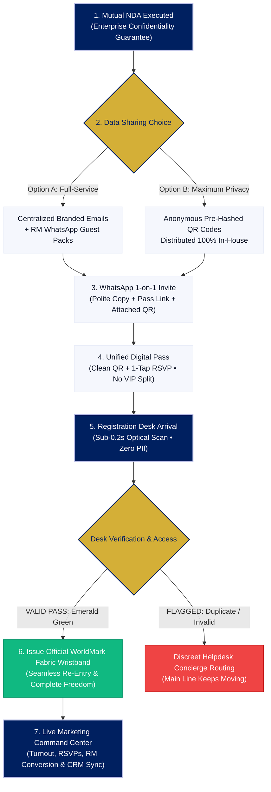

# WorldMark 6 Launch Event: Guest Registration & Check-In Flow
**Prepared for:** WorldMark 6 Marketing Leadership & Event Organizing Committee  
**Prepared by:** WiserStack Event Solutions  
**Date:** October 2026  
**Presentation Deck (PDF):** [Download / Open PDF Deck](file:///c:/Users/ramag/Documents/antigravity/jolly-einstein/docs/presentations/worldmark6-event-checkin-deck.pdf)  
**Interactive Slide Deck (HTML):** [Open HTML Slide Deck](file:///c:/Users/ramag/Documents/antigravity/jolly-einstein/docs/presentations/worldmark6-event-checkin-deck.html)

---

## Executive Summary

The launch of **WorldMark 6** is a flagship milestone welcoming senior corporate leaders, prospective commercial tenants, retail brands, and distinguished guests. The registration desk is the very first physical touchpoint of the event. 

This 9-slide visual presentation deck outlines a **queue-free, privacy-first, hospitality-grade check-in flow** that guarantees:
1. **Sub-second check-in (< 0.2s)** to eliminate queue bottlenecks entirely.
2. **Ironclad guest privacy (Zero PII on desk screens)** so volunteers and bystanders cannot view attendee names, corporate affiliations, or contact numbers.
3. **High-touch WhatsApp outreach** with personal 1-on-1 Relationship Manager invites and 1-tap mobile pass previews.
4. **Official WorldMark fabric wristband issuance** for total in-venue freedom and frictionless re-entry.
5. **Unified guest experience** — all attendees receive equal, first-class admission without artificial tier divisions.
6. **Complete data flexibility for WorldMark 6** — choose between automated turnkey distribution or 100% in-house private distribution without sharing guest lists.
7. **Live marketing intelligence** tracking RSVPs, Relationship Manager (RM) outreach conversion, and real-time venue footfall to measure marketing outcomes.
8. **Direct executive contact** with WiserStack founder & leadership for turnkey execution.

---

## Visual End-to-End Guest Journey



---

## Slide-by-Slide Deck Outline & Talking Points

```carousel
### Slide 1: Title & Executive Vision
<!-- slide -->
### Slide 2: Why WiserStack & Leadership Team
<!-- slide -->
### Slide 3: Marquee Brands That Trust WiserStack
<!-- slide -->
### Slide 4: Step 1 — Trust & Security (Mutual NDA)
<!-- slide -->
### Slide 5: Step 2 — Flexible Guest Invitation Flow (Option A vs B)
<!-- slide -->
### Slide 6: Step 3 — The High-Touch Guest Experience (WhatsApp Mockup & Mobile Pass)
<!-- slide -->
### Slide 7: Step 4 — Rapid Desk Scan & Official WorldMark Wristband (Combined)
<!-- slide -->
### Slide 8: Step 5 — Live Marketing Command Center & ROI Metrics
<!-- slide -->
### Slide 9: Next Steps & Executive Contact
```

---

### Slide 1: Title & Executive Vision
* **Visual Elements:**
  * Official WiserStack logo in signature Royal Navy (`#002060`) alongside the WorldMark 6 Launch Event badge.
  * 4 Core Metric Highlights:
    * **< 0.2s Scan & Admit:** Instant gate clearance with zero queue bottlenecks.
    * **100% Zero-PII Display:** Zero attendee names or contact details on volunteer screens.
    * **Flexible Data Control:** Choose automated dispatch or 100% in-house data retention.
    * **Live ROI Metrics:** Real-time RSVP conversions and Relationship Manager footfall.
* **Speaker Script:**
  > *"Good morning, WorldMark 6 marketing team. Today, we're sharing the end-to-end guest journey for your upcoming launch event. Our goal is simple: ensure every attendee experiences a dignified, zero-wait arrival, while giving your marketing team complete visibility into guest turnout and RM outreach in real time."*

---

### Slide 2: About WiserStack — Built for Live Event Realities
* **Visual Elements:**
  * Left Column: 4 Track Record Pillars
    * **1,200+ Real Events Supported:** Battle-tested operational experience across luxury banquets, conventions, and flagship property launches.
    * **Patented Tech:** Years of core R&D building AI vision for guest counting, crowd flow, and event tracking.
    * **Domain Depth:** Deep operational mastery of luxury banquet logistics, concierge flow, and queue psychology.
    * **AI-First & Scalable:** Offline-tolerant architecture engineered never to fail during live arrival surges.
  * Core Philosophy Quote:
    > *“Any technology company can build software. The hard part is turning hotel, venue, and banquet standards into tools that work during a live event.”*
  * Right Column: Core Leadership Bios (with portraits):
    * **Abhinav Goswami** — Founder & CEO: MBA (Gold Medalist) – IIM Bangalore, CA | 15+ Yrs Exp. in Product, Sales & Finance | 2X Founder
    * **Prabhat Ranjan** — Founding Engineer: Open Source Contributor (Rust, JS) | 8+ Yrs Full Stack & Distributed Systems Exp.
    * **Mukilan S** — Founding Data Scientist: Kaggle Top 1% Global Expert | 6+ Yrs Applied Machine Learning & Predictive Analytics Exp.
* **Speaker Script:**
  > *"We are not a generic software vendor. WiserStack was built from the ground up for how luxury hospitality and live events really function. We have powered over 1,200 live events with patented tracking tech and an engineering team that specializes in high-stakes operational reliability."*

---

### Slide 3: Proven Pedigree — Marquee Brands & Luxury Hospitality Venues
* **Visual Elements:**
  * Clean, curated 3-row grid showcase of India's leading 5-star hotel groups and premier catering brands that trust WiserStack (perfectly proportioned with zero truncation):
    * **Luxury Hotel Chains:** ITC Hotels (ITC Maurya, ITC Royal Bengal), Andaz (Hyatt) Delhi, Radisson Gurugram Udyog Vihar, Crowne Plaza (IHG) Gurugram, Tivoli Hotels & Resorts.
    * **Elite Catering & Venue Operators:** Foodlink, Creative Cuisines Inc (CCi), The Heritage Haveli, The Zora, GNH Grand Notting Hills, The Grandreams, The Purple Plate, Food Art Hospitality (FAH), Ambria Pushpanjali, Araya Bagh, FnP Venues, TGB.
* **Speaker Script:**
  > *"When WorldMark 6 partners with WiserStack, you are working with an event system proven across India's most prestigious hospitality brands—from ITC Maurya and Hyatt Andaz to the country's most renowned luxury caterers. Our infrastructure does not falter under pressure."*

---

### Slide 4: Step 1 — Trust & Security: Mutual NDA Upfront
* **Visual Elements:**
  * Enterprise confidentiality shield and governance pillars:
    * **Guest Confidentiality:** WorldMark 6's high-value corporate tenants, investors, and dignitaries remain protected under bilateral enterprise terms.
    * **Zero Data Monetization:** Attendee data is never stored beyond the event lifecycle, sold, or shared with advertising networks. Automatic post-event data purge.
    * **Role-Based Access Control:** Only authorized WorldMark 6 event directors retain permissions to access full attendee audit records.
* **Speaker Script:**
  > *"Step one is trust. Before any setup begins or guest records are touched, we execute a mutual NDA. WorldMark 6's invitees are institutional investors, property leaders, and corporate tenants. We treat your data with the highest enterprise standard."*

---

### Slide 5: Step 2 — Flexible Guest Invitation Flow: Two Options
* **Visual Comparison:**

| Feature | Option A: Full Service (Data Shared) | Option B: Maximum Privacy (In-House Data) |
| :--- | :--- | :--- |
| **Data Hand-Off** | WorldMark 6 provides attendee list (Name, Mobile/Email, RM). | **Zero guest data shared** with us. WorldMark 6 retains data 100% in-house. |
| **Email Invitations** | Centralized, branded invitations dispatched automatically. | WorldMark 6 marketing team sends invites via internal CRM/email channels. |
| **RM Concierge Packs** | Dedicated sub-folders per RM with QR images & WhatsApp copy. | Bulk pre-generated QR code library & private links handed over. |
| **RM Tracking** | Automated conversion dashboard broken down by RM. | Tracked by pass token IDs matched to internal WorldMark 6 roster. |
| **Best For** | Maximum speed, zero administrative overhead for your team. | Strict institutional confidentiality and compliance policies. |

* **Speaker Script:**
  > *"We offer complete flexibility on how data is handled. In Option A, you share the guest list with us, and we handle centralized email invitations while providing custom folders to each Relationship Manager for 1-on-1 WhatsApp outreach. In Option B, if your compliance prefers not to share guest lists, we generate anonymous cryptographic passes and links, and hand them over to your team to distribute entirely in-house. You maintain 100% control."*

---

### Slide 6: Step 3 — The High-Touch Guest Experience (WhatsApp Mockup & Mobile Pass)
* **Visual Elements:**
  * **Side-by-Side Split View:**
    1. **Authentic WhatsApp Chat UI (Left):**
       * Relationship Manager **Vikram Malhotra** (WorldMark 6 RM • Online) sending a 1-on-1 personal invitation bubble to a high-profile guest (e.g. *Mr. Kapoor*).
       * Includes polite formal copy, a rich web pass preview link card (`worldmark6.com/pass/WM6-409`), and an attached high-resolution QR image badge (`Pass_WM6-409.png`).
    2. **Interactive Mobile Pass Preview (Right):**
       * WorldMark 6 Launch Event branding, date, venue, valet notes.
       * **Unified Pass Status:** `"GUEST INVITATION PASS"` (all attendees receive equal, first-class admission without artificial tier divisions).
       * Clean raw-token QR code badge (`PASS ID: WM6-409`).
       * 3-Way RSVP Buttons: **"Attending (Yes)"**, **"Maybe"**, and **"Decline"**.
* **Critical Marketing Rule:**
  > **Valid Pass Admittance:** If an invited guest forgets to RSVP online beforehand, their QR pass is **still 100% valid at the entrance**. The scanner admits them immediately—no guest is ever turned away or delayed at the door.
* **Speaker Script:**
  > *"Every guest receives a warm, personal 1-on-1 touch. Whether received via official email or forwarded personally by their Relationship Manager over WhatsApp, tapping the link brings up an elegant mobile pass with a 1-tap RSVP. Crucially, if a guest forgets to RSVP beforehand, their pass still works instantly at the door. No awkward pauses or delays."*

---

### Slide 7: Step 4 — Rapid Desk Scan & Official Wristband (Step-Wise 3-Column Flow)
* **Visual Elements (Laid out horizontally, one next to another):**
  * **Step 1: Rapid 2D Optical Scan (Left):**
    * High-speed presentation scanner reading QR pass with sub-200ms optical read (< 14ms verification).
    * 100% offline-resilient architecture with zero Wi-Fi dependencies.
  * **Step 2: Zero-PII Verification Screen (Middle):**
    * Desk screen displaying large green `"VALID PASS — ADMIT"` banner, `PASS: WM6-409`, and `LAUNCH ACCESS`.
    * 🚫 **Complete Privacy Guarantee:** Volunteer screens display zero attendee names, phone numbers, or corporate designations.
  * **Step 3: Official WorldMark Fabric Wristband (Right):**
    * Embedded photograph of the official **WorldMark New Delhi branded fabric wristband** with sliding security clasp.
    * **Seamless Re-Entry:** Guests move freely to the terrace, valet, or foyer without re-scanning phones.
    * **Discreet Helpdesk:** Duplicate or unrecognized passes route quietly to an adjacent concierge desk, preventing any arrival bottleneck.
* **Speaker Script:**
  > *"When an attendee arrives, the registration desk scans their QR pass in under 0.2 seconds. Volunteers only see a bright green 'VALID PASS - ADMIT' banner—zero personal details are revealed. Once validated, the guest is handed the official WorldMark New Delhi fabric wristband, granting them complete freedom to move between the ballroom, terrace, and valet without re-scanning."*

---

### Slide 8: Step 5 — Live Marketing Command Center: ROI & Metrics
* **Visual Elements:**
  * **Top Metrics Ribbon (4 Cards):**
    * Total Invited (400)
    * Confirmed RSVPs (342 • 85.5%)
    * Actual Venue Turnout (289 • 72.2%)
    * Peak Arrival Velocity (42 guests / 15 min peak)
  * **Relationship Manager (RM) Scorecard Table (Left, 7 Cols):**
    * Track invited vs. attended guests per RM (Vikram Malhotra, Ananya Sharma, Rohan Verma, Priya Nair).
    * Automated conversion tracking and status indicators.
  * **Real-Time Marketing Action Center (Right, 5 Cols):**
    * ⚡ **Instant VIP Arrival Ping:** RM receives an automatic SMS notification when their key anchor tenant checks in.
    * 📊 **2:00 PM Unconfirmed Follow-Up:** 1-click filter for guests who haven't RSVP'd yet, allowing RMs to dispatch a polite afternoon WhatsApp nudge.
  * **One-Click Post-Event Export:** Reconciled attendance CSV with exact arrival timestamps for CRM synchronization (Salesforce, Zoho, HubSpot).
* **Speaker Script:**
  > *"Throughout the evening, your marketing leadership has a live dashboard. You see exactly how many people have arrived, what percentage of RSVPs turned out, and which Relationship Managers drove the highest engagement. At the end of the evening, you download a complete, reconciled audit log ready for post-event CRM follow-up."*

---

### Slide 9: Next Steps & Launch Readiness
* **4-Phase Implementation Roadmap (Horizontal 4-Col Grid):**
  1. **Phase 1: Mutual NDA Sign-Off:** Execution of standard confidentiality agreement protecting attendee records.
  2. **Phase 2: Select Data Pathway:** Confirm Option A (turnkey email + RM packs) or Option B (in-house distribution).
  3. **Phase 3: QR Passes & RM Packs:** Generation of cryptographic passes, branded links, and RM WhatsApp bundles.
  4. **Phase 4: Desk Setup & Live Run:** Pre-event desk dry-run at WorldMark 6 with fast 2D scanners, wristbands & dashboard.
* **Operational SLA Guarantees (3 Columns):**
  * **Turnkey Hardware Provided:** High-speed 2D optical presentation scanners, staff terminal tablets, and stand mounts.
  * **Dedicated On-Site Leads:** WiserStack engineering leads on ground 2 hours prior to arrival through event wrap.
  * **60-Min Reconciled Audit:** Complete attendance and RM conversion CSV delivered to marketing leadership within 1 hour.
* **Executive Contact Card:**
  * **Abhinav Goswami** — Founder & CEO, WiserStack
  * ✉️ **Email:** [abhinav@wiserstack.com](mailto:abhinav@wiserstack.com)
  * 📞 **Phone:** [+91-8929911811](tel:+918929911811)
  * *Available immediately to coordinate data pathways, dry run schedules, and registration desk hardware setup with the WorldMark 6 marketing team.*

---

## Brand Styling Specifications (WiserStack System)

* **Official Logo:** Rendered cleanly in the header, title slide, and executive contact card.
* **Primary Royal Navy:** `#002060` — Conveying institutional trust, luxury, and authority.
* **Secondary Accent:** `#BCC0E8` / `#5B6CB0` — Soft modern periwinkle for card accents and borders.
* **Background Canvas:** `#F5F7FD` — Crisp, clean off-white canvas for optimal contrast.
* **Accent Gold:** `#D4AF37` — Denoting key highlights, milestone badges, and contact CTA.
* **Status Emerald:** `#10B981` — High-visibility confirmation for `"VALID PASS - ADMIT"`.
* **Typography:** `Plus Jakarta Sans` / System Sans-serif, optimized for executive readability.
